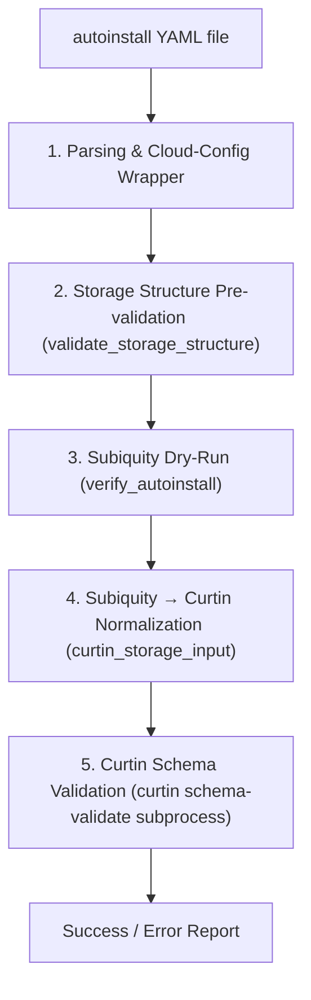

# Ubuntu Autoinstall Helper & Validator

[](https://github.com/amichalowski/ubuntu-autoinstall-helper/actions/workflows/ci.yml)
[](https://github.com/amichalowski/ubuntu-autoinstall-helper/actions/workflows/release.yml)
[](https://github.com/amichalowski/ubuntu-autoinstall-helper/releases)
[](https://github.com/amichalowski/ubuntu-autoinstall-helper/blob/main/LICENSE)
[](https://github.com/amichalowski/ubuntu-autoinstall-helper#system-requirements)
[](https://github.com/amichalowski/ubuntu-autoinstall-helper#system-requirements)
[](https://conventionalcommits.org)
[](https://github.com/astral-sh/ruff)


[](https://forthebadge.com)
[](https://forthebadge.com)
[](https://forthebadge.com)


[](https://forthebadge.com)


> [!NOTE]
> **Project Background & Vibecoding Disclaimer**  
> An additional goal of this project is to serve as a hands-on experiment in how **GitHub Actions** works (workflows, jobs, test/lint reporting, badges, and CI/CD in general).
> 
> This project is **full vibecoded** and serves, among other things, as an experimental testing ground and proving ground for using AI agents with Canonical's Workshop.
> 
> The inspiration for this script and multi-layer validation toolset was an `autoinstall.yaml` configuration erroneously generated by Gemini (now moved and renamed to [`wrong-autoinstall/autoinstall-wrong-storage.yaml`](wrong-autoinstall/autoinstall-wrong-storage.yaml)). That file contained broken storage configuration (such as invalid `wipe` parameters) that bypassed naive syntax checks but failed Curtin schema validation.
> 
> **Important:** The file in `wrong-autoinstall/` is **NOT** a working model or reference configuration. It is intentionally preserved as a negative test case to demonstrate error detection and prove why multi-layer validation is necessary.

A comprehensive set of tools for creating, multi-layer validating, and installing automated Ubuntu Server / Desktop configurations (`autoinstall` / Subiquity / Curtin) onto installation media (block devices, USB flash drives, or raw image files).

---

## Table of Contents

- [Project Background & Vibecoding Disclaimer](#ubuntu-autoinstall-helper--validator)
- [Key Features](#key-features)
- [Project Structure](#project-structure)
- [System Requirements](#system-requirements)
- [Development & Building (`uv` & `zipapp`)](#development--building-uv--zipapp)
- [Usage Guide](#usage-guide)
  - [1. Configuration Validation (`validate`)](#1-configuration-validation-validate)
  - [2. Flashing ISO Image (`flash`)](#2-flashing-iso-image-flash)
  - [3. Injecting Configuration into Media (`inject` / `cidata inject`)](#3-injecting-configuration-into-media-inject--cidata-inject)
  - [4. Extracting Configuration from Media (`extract` / `cidata extract`)](#4-extracting-configuration-from-media-extract--cidata-extract)
  - [5. Testing Installation Media in a VM (`vm`)](#5-testing-installation-media-in-a-vm-vm)
- [Architecture and Validation Layers](#architecture-and-validation-layers)
  - [Layer 1: Parsing & Cloud-Config Wrapper](#1-parsing--cloud-config-wrapper)
  - [Layer 2: Storage Structure Pre-validation](#2-storage-structure-pre-validation-validate_storage_structure)
  - [Layer 3: Subiquity Dry-Run](#3-subiquity-dry-run-verify_autoinstall)
  - [Layer 4: Subiquity → Curtin Normalization](#4-subiquity--curtin-normalization-curtin_storage_input)
  - [Layer 5: Curtin Schema Validation](#5-curtin-schema-validation-curtin-schema-validate-subprocess)
  - [What the Validator Intentionally Avoids Checking Manually](#what-the-validator-intentionally-avoids-checking-manually)
- [Erroneous Configuration Test Case (`wrong-autoinstall`)](#erroneous-configuration-test-case-wrong-autoinstall)

---

## Key Features

- **Automated and Safe Validation**: Runs validation inside an isolated Docker container matching the installer channel specified in the autoinstall YAML (e.g., `24.04/stable`, `26.04/stable`).
- **Smart Version Resolution**: Automatically queries the Snap Store API for the required `ubuntu-desktop-bootstrap` version without needing `snapd` installed on the host.
- **Media Preparation**: Safely writes ISO images to disks, USB flash drives, or virtual raw image files with automated space reservation (128 MB) for the `cidata` partition.
- **`cidata` Partition Management**: Creates FAT32 partitions labeled `cidata`, injects `user-data` and `meta-data`, and extracts existing configurations from media.
- **GPT Resilience**: Automatically repairs secondary/backup GPT partition tables after raw flashing operations.
- **VM Media Testing**: Boots a prepared installation image (`pendrive.img`) in a throwaway libvirt/QEMU VM as a removable USB disk (`vm create` / `eject` / `reinstall` / `delete`), so the autoinstall flow can be verified without physical hardware and without root privileges.

---

## Project Structure

```text
.
├── .github/workflows/ci.yml                   # GitHub Actions: pytest (JUnit reporting) + ruff (tests, lint)
├── .github/workflows/release.yml              # Tag-driven release: CI gate → zipapp build → release notes → GitHub Release
├── .pre-commit-config.yaml                    # Local git hooks (git config core.hooksPath .githooks)
├── cliff.toml                                 # git-cliff config: release notes from Conventional Commits
├── pyproject.toml                             # Project metadata, console scripts, ruff config
├── AGENTS.md                                  # Repository guidelines for AI agents
├── src/
│   └── autoinstall_helper/
│       ├── __init__.py
│       ├── __main__.py                        # Module entry point (python -m autoinstall_helper)
│       ├── cli.py                             # Main CLI implementation and command dispatch
│       ├── config.py                          # autoinstall.yaml parsing & validation
│       ├── snapstore.py                       # Snap Store API queries and base → Ubuntu image mapping
│       ├── docker_utils.py                    # Docker image management and docker/ asset extraction
│       ├── flash.py                           # ISO flashing to block devices / image files
│       ├── cidata.py                          # cidata (FAT32) partition injection & extraction
│       ├── disk.py                            # Block device and GPT backup header helpers
│       ├── vm.py                              # libvirt/QEMU VMs booting installation media
│       ├── fsprobe.py                         # Filesystem metadata seam (existence/type/size, never contents)
│       ├── interactions.py                    # Shared fake response + URL/header extraction helpers
│       ├── recorder.py                        # Dev mode: record subprocess/network/filesystem interactions
│       ├── replayer.py                        # Replay recorded interactions for hermetic tests
│       ├── build.py                           # Standalone zipapp (.pyz) builder
│       └── docker/
│           ├── __init__.py
│           ├── Dockerfile                     # Container definition with matching Subiquity/Curtin version
│           ├── timedatectl.sh                 # timedatectl mock for Subiquity dry-run
│           └── validate-autoinstall.py        # In-container 5-layer validation script
├── tests/                                     # Comprehensive unit test suite (pytest)
│   ├── test_build.py                          # zipapp packaging, docker digest and asset extraction tests
│   ├── test_cli.py                            # CLI parsing, dispatch and root-privilege tests
│   ├── test_config.py                         # autoinstall.yaml parsing tests
│   ├── test_cidata.py                         # cidata helper tests
│   ├── test_docker_utils.py                   # Docker preflight (`validate doctor`) and image management tests
│   ├── test_vm.py                             # libvirt VM command construction and XML tests
│   ├── test_validate_autoinstall.py           # Subiquity/Curtin validation and normalization tests
│   ├── replay/                                # Recorded-replay component tier (marker: replay; scaffolded)
│   │   ├── README.md                          # Scenario plan + recording recipe (--record)
│   │   ├── conftest.py                        # replayed_session fixture (patches subprocess/urllib/fsprobe)
│   │   └── fixtures/                          # Committed *.recording.json sessions (none yet)
│   └── smoke/
│       ├── conftest.py                        # Shared artifact/run fixtures for the smoke tests
│       ├── test_artifact_cli.py               # Packaged CLI contract: parsing, exit codes, no asset extraction
│       ├── test_artifact_validate.py          # End-to-end validation smoke tests (Docker, pytest marker: smoke)
│       └── test_artifact_vm.py                # Packaged `vm` command contract (dry-run, doctor)
├── wrong-autoinstall/
│   └── autoinstall-wrong-storage.yaml         # Erroneous config generated by Gemini (broken storage, NOT a reference file)
├── plan_testów.md                             # Unit test plan for the CLI and validation scripts
└── README.md                                  # Project and architecture documentation
```

---

## System Requirements

- **Python 3.10+** (with `python3-yaml` or `PyYAML` package)
- **uv** (recommended for local development and running tests)
- **Docker** (required for `validate` command):
  - Membership in the `docker` group (`sudo usermod -aG docker $USER`, then log out and back in); no `sudo` is needed to run the tool
  - Run `autoinstall-helper validate doctor` to check the host
- **System Utilities** (for disk operations: `flash`, `inject`, `extract`):
  - `sfdisk`, `parted`, `gdisk` / `sgdisk`
  - `mkfs.vfat` (`dosfstools`), `mtools`
  - `fallocate`, `losetup`
  - Administrator privileges (`sudo`) when operating on block devices
- **libvirt / QEMU** (optional, required only for the `vm` command):
  - `virtinst`, `qemu-system-x86`, `libvirt-daemon-system`, `ovmf`, `swtpm`, `virt-viewer`
  - Membership in the `libvirt` and `kvm` groups (`sudo usermod -aG libvirt,kvm $USER`); no `sudo` is needed to run the tool
  - Run `autoinstall-helper vm doctor` to check the host

---

## Development & Building (`uv` & `zipapp`)

The project follows a standard `src/` layout managed with [`uv`](https://docs.astral.sh/uv/) and maintains a strict **zero external runtime dependencies** rule for production code.

### Running in Development

```bash
# Run CLI directly through uv
uv run autoinstall-helper --help
uv run autoinstall-helper validate autoinstall.yaml

# Run unit tests
uv run pytest -v

# Run the hermetic recorded-replay component tests (no Docker/network/devices)
# (tier is scaffolded — see tests/replay/README.md for the recording plan)
uv run pytest -m replay -v

# Lint & format check (ruff version pinned in uv.lock — same as CI)
uv run ruff check .
uv run ruff format --check .
```

### Dev mode: recording interactions (`--record`)

The `--record` flag captures every `subprocess`, `urllib`, and filesystem-metadata interaction of a session into a single, committable JSON file. It is a **dev-only** feature (the flag must precede the subcommand):

```bash
# Record a real session (run on a host with the required tools/devices)
uv run autoinstall-helper --record tests/replay/fixtures/flash-new-target.recording.json flash respin.iso target.img --yes

# Replay it deterministically, with no ISO, device, Docker, or network
uv run pytest -m replay -v
```

Only metadata is captured for paths (existence, type, size) and only exit codes plus console output for processes — disk images, ISOs, and block devices are never written into fixtures. See [`docs/design/dev-mode-recording.md`](docs/design/dev-mode-recording.md) for the format and architecture, and [`tests/replay/README.md`](tests/replay/README.md) for the scenario plan of recordings to make.

### Local pre-commit hook

Ruff runs in CI (`lint` job), but you can get instant feedback on every commit by installing the git hooks:

```bash
# One-time setup per clone: activates ruff check + ruff format on staged files
pre-commit install
```

The hook is generated by `pre-commit` (see [`.pre-commit-config.yaml`](.pre-commit-config.yaml)), so the local version is always identical to the one enforced in CI. The host uses the default `.git/hooks`; the dev workshop sets `core.hooksPath` to `.githooks-workshop` in `/etc/gitconfig`, so each side gets its own hook with the interpreter of its own environment. The generated workshop directory is ignored by git.

### Building Standalone Executable (`zipapp`)

You can compile the entire application into a single, self-contained executable file (`.pyz`) using Python's standard `zipapp` module:

```bash
# Build autoinstall-helper.pyz in the project root
uv run build-pyz

# Or specify a custom output path
uv run build-pyz -o dist/autoinstall-helper.pyz
```

The resulting `autoinstall-helper.pyz` has **zero external package dependencies** and runs on any standard Ubuntu system with `python3`:

```bash
chmod +x autoinstall-helper.pyz
./autoinstall-helper.pyz --help
```

> [!NOTE]
> When executing the `validate` command from within a `.pyz` archive, the required Docker build context assets (`Dockerfile`, `timedatectl.sh`, `validate-autoinstall.py`) are automatically and lazily extracted into a temporary directory in `/tmp` and cleaned up upon exit. Commands that do not use Docker (`flash`, `inject`, `extract`) never perform extraction.

### Releases (GitHub Actions)

Releases are driven by **semver tags** pushed to the repository:

| Tag | Type | Example |
| --- | --- | --- |
| `vX.Y.Z` | Stable release | `v0.2.0` |
| `vX.Y.Z-rc.N` / `vX.Y.Z-beta.N` | Prerelease | `v0.2.0-rc.1` |

Pushing a tag triggers [`.github/workflows/release.yml`](.github/workflows/release.yml), which:

1. **Quality gate** — runs the exact same pytest + ruff jobs as CI (reused from [`ci.yml`](.github/workflows/ci.yml) via `workflow_call`) on the tagged commit.
2. **Version guard** — fails if the tag base does not match the version in `pyproject.toml` (e.g. tag `v0.2.0-rc.1` requires `0.2.0`).
3. **Build** — produces `autoinstall-helper-<tag>.pyz` and a `SHA256SUMS` file.
4. **Smoke test** — executes the built artifact against the known-bad [`wrong-autoinstall/autoinstall-wrong-storage.yaml`](wrong-autoinstall/autoinstall-wrong-storage.yaml) and requires the validation to fail; the release is blocked otherwise.
5. **Publish** — generates release notes from [Conventional Commits](https://conventionalcommits.org) using [`git-cliff`](https://git-cliff.org) (see [`cliff.toml`](cliff.toml)) and creates a GitHub Release with the artifacts attached. Tags with a semver prerelease suffix are marked as **prerelease** and excluded from "Latest".

To cut a release:

```bash
# 1. Make sure pyproject.toml version matches the upcoming tag base (here: 0.2.0)
# 2. Tag and push:
git tag -a v0.2.0-rc.1 -m "v0.2.0-rc.1"   # release candidate (prerelease)
git push origin v0.2.0-rc.1

git tag -a v0.2.0 -m "v0.2.0"             # final release
git push origin v0.2.0
```

**Smoke tests** live in `tests/smoke/` and carry the pytest marker `smoke`. They exercise the built `.pyz` end-to-end (Docker image build + validation container), so they require Docker and network access and are excluded from the default test run:

```bash
uv run build-pyz -o dist/autoinstall-helper.pyz
uv run pytest -m smoke -v
```

> [!NOTE]
> Release notes are generated from the commits between the pushed tag and the previous tag. A final release published after a release candidate therefore contains only the changes made since that candidate; use `gh release edit <tag>` to enrich the notes manually if needed.

---

## Usage Guide

You can run commands either via `uv run autoinstall-helper` (in dev) or via `./autoinstall-helper.pyz` (standalone):

### 1. Configuration Validation (`validate`)

Reads the installer channel from the YAML file, queries the Snap Store API for the exact package version, builds the Docker container (if not already cached), and runs multi-layer validation:

> [!IMPORTANT]
> The file **must** start with the `#cloud-config` header. Without it the command fails immediately with a clear error, before contacting the Snap Store or Docker.

```bash
# Check the host first (docker binary, daemon reachable, access without sudo)
uv run autoinstall-helper validate doctor

# Validate a specific autoinstall configuration
uv run autoinstall-helper validate path/to/your-autoinstall.yaml
# Or with standalone .pyz:
./autoinstall-helper.pyz validate path/to/your-autoinstall.yaml

# Test against the erroneous Gemini-generated test case
uv run autoinstall-helper validate wrong-autoinstall/autoinstall-wrong-storage.yaml

# Choose validation scope:
#   --validation full        (default: Subiquity dry-run + Curtin schema)
#   --validation autoinstall (Subiquity only)
#   --validation storage     (storage only: structure pre-validation + Curtin schema)
uv run autoinstall-helper validate wrong-autoinstall/autoinstall-wrong-storage.yaml --validation storage

# List the validator images built so far (tag, size, age, digest status)
uv run autoinstall-helper validate images

# Remove images built from outdated docker/ assets (old digest in the tag):
uv run autoinstall-helper validate images --prune --dry-run   # preview
uv run autoinstall-helper validate images --prune -y          # remove
# ... or wipe every validator image to reclaim disk space:
uv run autoinstall-helper validate images --prune --all -y
```

Images are tagged `<version>-<digest>`, where the digest covers the bundled `Dockerfile`, `timedatectl.sh` and `validate-autoinstall.py`. `validate images` compares that tag against the assets shipped with the running tool (no network), so `stale` means "built before the validator assets changed" — the next `validate` run rebuilds it automatically.

### 2. Flashing ISO Image (`flash`)

Writes an installation ISO image to a target block device (e.g., USB drive `/dev/sdb`) or to a raw image file:

```bash
# Flash to USB drive (requires root privileges)
sudo uv run autoinstall-helper flash ubuntu-24.04-desktop-amd64.iso /dev/sdb
# Or with standalone .pyz:
sudo ./autoinstall-helper.pyz flash ubuntu-24.04-desktop-amd64.iso /dev/sdb

# Flash bypassing interactive confirmation prompt
sudo ./autoinstall-helper.pyz flash ubuntu-24.04-desktop-amd64.iso /dev/sdb -y

# Flash to an image file (automatically expands the file with extra space for cidata)
./autoinstall-helper.pyz flash ubuntu-24.04-desktop-amd64.iso target.img
```

### 3. Injecting Configuration into Media (`inject` / `cidata inject`)

Creates or updates a `cidata` partition (FAT32) on the target media and writes configuration into `user-data`:

```bash
# Inject autoinstall configuration into media
sudo ./autoinstall-helper.pyz inject /dev/sdb my-autoinstall.yaml

# Equivalent syntax using the cidata command group:
sudo ./autoinstall-helper.pyz cidata inject /dev/sdb my-autoinstall.yaml
```

### 4. Extracting Configuration from Media (`extract` / `cidata extract`)

Reads existing `user-data` from a `cidata` partition and saves it locally:

```bash
# Export configuration from a block device to an output file
sudo ./autoinstall-helper.pyz extract /dev/sdb exported.yaml

# Equivalent syntax using the cidata command group:
sudo ./autoinstall-helper.pyz cidata extract /dev/sdb exported.yaml
```

### 5. Testing Installation Media in a VM (`vm`)

Boots a prepared installation image (as produced by `flash` + `inject`, e.g.
`pendrive.img`) in a throwaway libvirt/QEMU VM. The image is attached as a
removable USB disk, so the whole autoinstall flow can be verified without
physical hardware. The VM runs **detached from the terminal** by default
(`--noautoconsole`), and no root privileges are required — access is granted
through the `libvirt` and `kvm` groups.

```bash
# Check the host first (tools, /dev/kvm, UEFI firmware, libvirt access)
uv run autoinstall-helper vm doctor

# Create and start a VM in the background
uv run autoinstall-helper vm create test-vm --media pendrive.img

# Preview the exact virt-install command without running it
uv run autoinstall-helper vm create test-vm --media pendrive.img --dry-run

# Attach to the console later (SPICE GUI by default, or the serial console)
uv run autoinstall-helper vm console test-vm
uv run autoinstall-helper vm console test-vm --serial

# After the installation completes: eject the media and boot the installed system
uv run autoinstall-helper vm eject test-vm --reboot

# Reinstall on the existing disk (the installer reformats it) ...
uv run autoinstall-helper vm reinstall test-vm
# ... or recreate the target disk image from scratch first
uv run autoinstall-helper vm reinstall test-vm --reset-disk

# Remove the VM definition but keep pendrive.img intact
uv run autoinstall-helper vm delete test-vm
# Also remove the VM target disk image (the installation media is never touched)
uv run autoinstall-helper vm delete test-vm --purge-disk -y

# Overview (managed VMs only; --all also lists foreign libvirt domains)
uv run autoinstall-helper vm list
uv run autoinstall-helper vm list --all
uv run autoinstall-helper vm status test-vm
```

`vm create` options:

| Option | Default | Meaning |
| --- | --- | --- |
| `--media IMG` | *(required)* | Installation image attached as a removable USB disk |
| `--disk PATH` | — | Reuse an existing target disk image instead of allocating one |
| `--disk-size GiB` | `40` | Size of the allocated target disk |
| `--memory MB` / `--vcpus N` | `4096` / `4` | VM resources |
| `--firmware uefi\|bios` | `uefi` | Firmware type |
| `--no-tpm` | TPM 2.0 on | Add/omit the emulated TPM 2.0 device |
| `--network` | `default` (system) / `user` (session) | libvirt network specification |
| `--graphics` | `spice` | `spice`, `vnc`, or `none` (pair with `--serial`) |
| `--wait` | off (detached) | Attach to the console instead of detaching from the terminal |
| `--reinstall` | off | Reinstall on the existing disk when the domain already exists |
| `--uri` | auto | libvirt URI (`qemu:///system` preferred, `qemu:///session` fallback) |

> [!IMPORTANT]
> `vm delete` never runs `virsh undefine --remove-all-storage`: the installation
> media is attached as a disk and would be destroyed together with the VM. Only
> `--purge-disk` removes the target disk, and it never touches `--media`.

The libvirt domain is the single source of truth — the tool keeps no registry of
its own. Domains created here carry a marker in their `<description>`:

```text
autoinstall-helper: tool=autoinstall-helper managed=auto media=/path/pendrive.img
```

- `tool=autoinstall-helper` — unambiguous tag: `vm list` shows **only** VMs
  carrying this marker (use `vm list --all` to also see foreign libvirt domains).
- `managed=auto|manual` — the target disk was allocated by libvirt (`--disk-size`)
  or provided by the user (`--disk`).
- `media=<path>` — lets `vm reinstall` re-attach the installation medium and
  `vm delete --purge-disk` tell the VM disk apart from the medium, which is never
  deleted.

Inspect the marker directly with `virsh desc NAME`.

---

## Architecture and Validation Layers

The autoinstall configuration verification process inside the container (`docker/validate-autoinstall.py`) relies on 5 specialized layers, ensuring full compatibility without duplicating upstream logic:



### 1. Parsing & Cloud-Config Wrapper
- **What it does:** The Subiquity validator (`validate-autoinstall.py`) parses the YAML and unpacks the `autoinstall:` section from the cloud-config header. It verifies the presence of the `#cloud-config` header and the top-level `autoinstall` key.
- **Why:** This is the only stage where raw input format is checked before further processing. The parsing logic is delegated directly to Subiquity to prevent divergence from upstream behavior.

### 2. Storage Structure Pre-validation (`validate_storage_structure`)
- **What it does:** Verifies elementary structural requirements: ensures the `storage` field is a dictionary, `config` is a list, each action is a dictionary, and action `id` fields are non-empty and unique across the entire configuration.
- **Why:** `curtin schema-validate` does not enforce uniqueness of `id` fields, whereas Subiquity crashes with an unhelpful `KeyError` when encountering duplicate IDs. This layer deliberately avoids domain-specific whitelists (action types, allowed fields, or enum values), removing the need for manual code synchronization with newer Subiquity/Curtin releases.

### 3. Subiquity Dry-Run (`verify_autoinstall`)
- **What it does:** Runs Subiquity in dry-run mode—loading the full configuration through the official installer code path (`load_autoinstall_config`). It catches issues such as invalid `layout.name`, broken action dependencies, missing root mount point (`/`), `size=-1` on non-final partitions, and errors in other sections (e.g., `network`, `identity`).
- **Why:** Subiquity is the authoritative source of truth for installer semantics. All higher-level business logic is evaluated directly by the installer's production code.

### 4. Subiquity → Curtin Normalization (`curtin_storage_input`)
- **What it does:** Transforms `storage.config` into a format compliant with Curtin:
  - Strips Subiquity extensions like `disk.match` (injecting a synthetic path `/dev/autoinstall-match` when no explicit device ID is provided, allowing Curtin's required-field validation to pass).
  - Normalizes dynamic partition sizes (`size=-1` and `size=N%`) into valid literal values (e.g., `"1B"`), satisfying Curtin JSON Schema's requirement of `size >= 1`.
  - Backfills missing `dm_crypt.dm_name` values based on the action `id`, mirroring Curtin's default runtime behavior.
- **Why:** Subiquity extends Curtin syntax with its own features. Without normalization, `curtin schema-validate` would falsely reject valid Subiquity configurations.

### 5. Curtin Schema Validation (`curtin schema-validate` subprocess)
- **What it does:** Executes `curtin schema-validate --storage --config <file>` against the normalized YAML. Curtin validates every action against strict JSON Schemas (`additionalProperties: false`), catching typos, unknown fields, invalid types, or missing required attributes.
- **Why:** Curtin is the authoritative source for storage rules. Executing it as a subprocess rather than importing private Python modules decouples the validator from internal API changes and ensures fidelity to the installer package version.

### What the Validator Intentionally Avoids Checking Manually

Subiquity deliberately **ignores unknown action types and unrecognized fields** to maintain forward and backward compatibility. The `curtin schema-validate` layer catches these anomalies after normalization. Our codebase does not hardcode rigid lists of allowed values, making it resilient to Ubuntu package updates.

---

## Erroneous Configuration Test Case (`wrong-autoinstall`)

The file located at [`wrong-autoinstall/autoinstall-wrong-storage.yaml`](wrong-autoinstall/autoinstall-wrong-storage.yaml) is the original configuration generated by Gemini that prompted the creation of this validator toolset:

- **What was attempted:**
  - Modern workstation setup on Ubuntu `26.04/stable` (or `24.04/stable`).
  - UEFI + GPT partitioning with a 1 GB `/boot/efi` partition.
  - Full-disk encryption with LUKS2 bound to TPM 2.0.
  - Btrfs filesystem with `@` (mounted at `/`) and `@home` (mounted at `/home`) subvolumes.
  - Interactive identity section (`interactive-sections: [identity]`).
  - Automated driver and codec installations.
- **Why it failed:**
  - The storage definition generated by Gemini contained invalid values such as `wipe: superblock-data` on `disk-main` (Curtin's JSON schema only permits `['random', 'superblock', 'superblock-recursive', 'zero']`), alongside Btrfs/LUKS relationship ambiguities.
  - While basic linters consider it valid YAML and Subiquity's dry-run may overlook some unrecognized fields, Curtin schema validation rejects it immediately.
- **Reminder:** This file is preserved exclusively as a test case to verify that the validator correctly catches invalid storage definitions. **Do not use it as a reference for production installations.**
