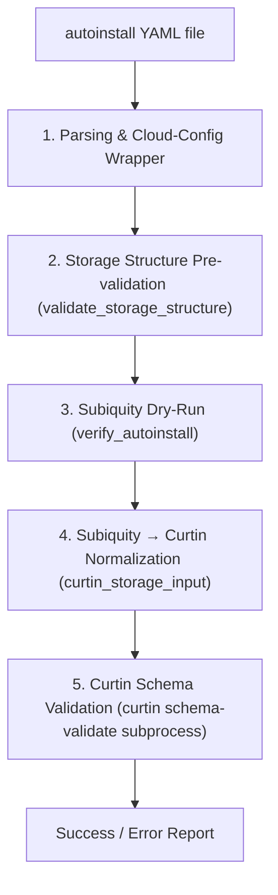

# Ubuntu Autoinstall Helper & Validator

[](https://conventionalcommits.org)

> [!NOTE]
> **Project Background & Vibecoding Disclaimer**  
> This project is **full vibecoded** and serves, among other things, as an experimental testing ground and proving ground for using AI agents with Canonical's Workshop.
> 
> The inspiration for this script and multi-layer validation toolset was an `autoinstall.yaml` configuration erroneously generated by Gemini (now moved and renamed to [`wrong-autoinstall/autoinstall-wrong-storage.yaml`](wrong-autoinstall/autoinstall-wrong-storage.yaml)). That file contained broken storage configuration (such as invalid `wipe` parameters) that bypassed naive syntax checks but failed Curtin schema validation.
> 
> **Important:** The file in `wrong-autoinstall/` is **NOT** a working model or reference configuration. It is intentionally preserved as a negative test case to demonstrate error detection and prove why multi-layer validation is necessary.

A comprehensive set of tools for creating, multi-layer validating, and installing automated Ubuntu Server / Desktop configurations (`autoinstall` / Subiquity / Curtin) onto installation media (block devices, USB flash drives, or raw image files).

---

## Table of Contents

- [Project Background & Vibecoding Disclaimer](#ubuntu-autoinstall-helper--validator)
- [Key Features](#key-features)
- [Project Structure](#project-structure)
- [System Requirements](#system-requirements)
- [Usage Guide (`autoinstall-helper.py`)](#usage-guide-autoinstall-helperpy)
  - [1. Configuration Validation (`validate`)](#1-configuration-validation-validate)
  - [2. Flashing ISO Image (`flash`)](#2-flashing-iso-image-flash)
  - [3. Injecting Configuration into Media (`inject` / `cidata inject`)](#3-injecting-configuration-into-media-inject--cidata-inject)
  - [4. Extracting Configuration from Media (`extract` / `cidata extract`)](#4-extracting-configuration-from-media-extract--cidata-extract)
- [Architecture and Validation Layers](#architecture-and-validation-layers)
  - [Layer 1: Parsing & Cloud-Config Wrapper](#1-parsing--cloud-config-wrapper)
  - [Layer 2: Storage Structure Pre-validation](#2-storage-structure-pre-validation-validate_storage_structure)
  - [Layer 3: Subiquity Dry-Run](#3-subiquity-dry-run-verify_autoinstall)
  - [Layer 4: Subiquity → Curtin Normalization](#4-subiquity--curtin-normalization-curtin_storage_input)
  - [Layer 5: Curtin Schema Validation](#5-curtin-schema-validation-curtin-schema-validate-subprocess)
  - [What the Validator Intentionally Avoids Checking Manually](#what-the-validator-intentionally-avoids-checking-manually)
- [Erroneous Configuration Test Case (`wrong-autoinstall`)](#erroneous-configuration-test-case-wrong-autoinstall)

---

## Key Features

- **Automated and Safe Validation**: Runs validation inside an isolated Docker container matching the installer channel specified in the autoinstall YAML (e.g., `24.04/stable`, `26.04/stable`).
- **Smart Version Resolution**: Automatically queries the Snap Store API for the required `ubuntu-desktop-bootstrap` version without needing `snapd` installed on the host.
- **Media Preparation**: Safely writes ISO images to disks, USB flash drives, or virtual raw image files with automated space reservation (128 MB) for the `cidata` partition.
- **`cidata` Partition Management**: Creates FAT32 partitions labeled `cidata`, injects `user-data` and `meta-data`, and extracts existing configurations from media.
- **GPT Resilience**: Automatically repairs secondary/backup GPT partition tables after raw flashing operations.

---

## Project Structure

```text
.
├── autoinstall-helper.py                      # Main CLI tool for validation, flashing, and cidata management
├── wrong-autoinstall/
│   └── autoinstall-wrong-storage.yaml         # Erroneous config generated by Gemini (broken storage, NOT a reference file)
├── docker/
│   ├── Dockerfile                             # Container definition with matching Subiquity/Curtin version
│   ├── timedatectl.sh                         # timedatectl mock for Subiquity dry-run
│   └── validate-autoinstall.py                # In-container 5-layer validation script
└── README.md                                  # Project and architecture documentation
```

---

## System Requirements

- **Python 3.10+** (with `PyYAML` package)
- **Docker** (required for `validate` command)
- **System Utilities** (for disk operations: `flash`, `inject`, `extract`):
  - `sfdisk`, `parted`, `gdisk` / `sgdisk`
  - `mkfs.vfat` (`dosfstools`), `mtools`
  - `fallocate`, `losetup`
  - Administrator privileges (`sudo`) when operating on block devices

---

## Usage Guide (`autoinstall-helper.py`)

The `autoinstall-helper.py` tool provides intuitive subcommands:

### 1. Configuration Validation (`validate`)

Reads the installer channel from the YAML file, queries the Snap Store API for the exact package version, builds the Docker container (if not already cached), and runs multi-layer validation:

```bash
# Validate a specific autoinstall configuration
./autoinstall-helper.py validate path/to/your-autoinstall.yaml

# Test against the erroneous Gemini-generated test case
./autoinstall-helper.py validate wrong-autoinstall/autoinstall-wrong-storage.yaml

# Choose validation scope:
#   --validation full        (default: Subiquity dry-run + Curtin schema)
#   --validation autoinstall (Subiquity only)
#   --validation storage     (storage only: structure pre-validation + Curtin schema)
./autoinstall-helper.py validate wrong-autoinstall/autoinstall-wrong-storage.yaml --validation storage
```

### 2. Flashing ISO Image (`flash`)

Writes an installation ISO image to a target block device (e.g., USB drive `/dev/sdb`) or to a raw image file:

```bash
# Flash to USB drive (requires root privileges)
sudo ./autoinstall-helper.py flash ubuntu-24.04-desktop-amd64.iso /dev/sdb

# Flash bypassing interactive confirmation prompt
sudo ./autoinstall-helper.py flash ubuntu-24.04-desktop-amd64.iso /dev/sdb -y

# Flash to an image file (automatically expands the file with extra space for cidata)
./autoinstall-helper.py flash ubuntu-24.04-desktop-amd64.iso target.img
```

### 3. Injecting Configuration into Media (`inject` / `cidata inject`)

Creates or updates a `cidata` partition (FAT32) on the target media and writes configuration into `user-data`:

```bash
# Inject autoinstall configuration into media
sudo ./autoinstall-helper.py inject /dev/sdb my-autoinstall.yaml

# Equivalent syntax using the cidata command group:
sudo ./autoinstall-helper.py cidata inject /dev/sdb my-autoinstall.yaml
```

### 4. Extracting Configuration from Media (`extract` / `cidata extract`)

Reads existing `user-data` from a `cidata` partition and saves it locally:

```bash
# Export configuration from a block device to an output file
sudo ./autoinstall-helper.py extract /dev/sdb exported.yaml

# Equivalent syntax using the cidata command group:
sudo ./autoinstall-helper.py cidata extract /dev/sdb exported.yaml
```

---

## Architecture and Validation Layers

The autoinstall configuration verification process inside the container (`docker/validate-autoinstall.py`) relies on 5 specialized layers, ensuring full compatibility without duplicating upstream logic:



### 1. Parsing & Cloud-Config Wrapper
- **What it does:** The Subiquity validator (`validate-autoinstall-user-data.py`) parses the YAML and unpacks the `autoinstall:` section from the cloud-config header. It verifies the presence of the `#cloud-config` header and the top-level `autoinstall` key.
- **Why:** This is the only stage where raw input format is checked before further processing. The parsing logic is delegated directly to Subiquity to prevent divergence from upstream behavior.

### 2. Storage Structure Pre-validation (`validate_storage_structure`)
- **What it does:** Verifies elementary structural requirements: ensures the `storage` field is a dictionary, `config` is a list, each action is a dictionary, and action `id` fields are non-empty and unique across the entire configuration.
- **Why:** `curtin schema-validate` does not enforce uniqueness of `id` fields, whereas Subiquity crashes with an unhelpful `KeyError` when encountering duplicate IDs. This layer deliberately avoids domain-specific whitelists (action types, allowed fields, or enum values), removing the need for manual code synchronization with newer Subiquity/Curtin releases.

### 3. Subiquity Dry-Run (`verify_autoinstall`)
- **What it does:** Runs Subiquity in dry-run mode—loading the full configuration through the official installer code path (`load_autoinstall_config`). It catches issues such as invalid `layout.name`, broken action dependencies, missing root mount point (`/`), `size=-1` on non-final partitions, and errors in other sections (e.g., `network`, `identity`).
- **Why:** Subiquity is the authoritative source of truth for installer semantics. All higher-level business logic is evaluated directly by the installer's production code.

### 4. Subiquity → Curtin Normalization (`curtin_storage_input`)
- **What it does:** Transforms `storage.config` into a format compliant with Curtin:
  - Strips Subiquity extensions like `disk.match` (injecting a synthetic path `/dev/autoinstall-match` when no explicit device ID is provided, allowing Curtin's required-field validation to pass).
  - Normalizes dynamic partition sizes (`size=-1` and `size=N%`) into valid literal values (e.g., `"1B"`), satisfying Curtin JSON Schema's requirement of `size >= 1`.
  - Backfills missing `dm_crypt.dm_name` values based on the action `id`, mirroring Curtin's default runtime behavior.
- **Why:** Subiquity extends Curtin syntax with its own features. Without normalization, `curtin schema-validate` would falsely reject valid Subiquity configurations.

### 5. Curtin Schema Validation (`curtin schema-validate` subprocess)
- **What it does:** Executes `curtin schema-validate --storage --config <file>` against the normalized YAML. Curtin validates every action against strict JSON Schemas (`additionalProperties: false`), catching typos, unknown fields, invalid types, or missing required attributes.
- **Why:** Curtin is the authoritative source for storage rules. Executing it as a subprocess rather than importing private Python modules decouples the validator from internal API changes and ensures fidelity to the installer package version.

### What the Validator Intentionally Avoids Checking Manually

Subiquity deliberately **ignores unknown action types and unrecognized fields** to maintain forward and backward compatibility. The `curtin schema-validate` layer catches these anomalies after normalization. Our codebase does not hardcode rigid lists of allowed values, making it resilient to Ubuntu package updates.

---

## Erroneous Configuration Test Case (`wrong-autoinstall`)

The file located at [`wrong-autoinstall/autoinstall-wrong-storage.yaml`](wrong-autoinstall/autoinstall-wrong-storage.yaml) is the original configuration generated by Gemini that prompted the creation of this validator toolset:

- **What was attempted:**
  - Modern workstation setup on Ubuntu `26.04/stable` (or `24.04/stable`).
  - UEFI + GPT partitioning with a 1 GB `/boot/efi` partition.
  - Full-disk encryption with LUKS2 bound to TPM 2.0.
  - Btrfs filesystem with `@` (mounted at `/`) and `@home` (mounted at `/home`) subvolumes.
  - Interactive identity section (`interactive-sections: [identity]`).
  - Automated driver and codec installations.
- **Why it failed:**
  - The storage definition generated by Gemini contained invalid values such as `wipe: superblock-data` on `disk-main` (Curtin's JSON schema only permits `['random', 'superblock', 'superblock-recursive', 'zero']`), alongside Btrfs/LUKS relationship ambiguities.
  - While basic linters consider it valid YAML and Subiquity's dry-run may overlook some unrecognized fields, Curtin schema validation rejects it immediately.
- **Reminder:** This file is preserved exclusively as a test case to verify that the validator correctly catches invalid storage definitions. **Do not use it as a reference for production installations.**
