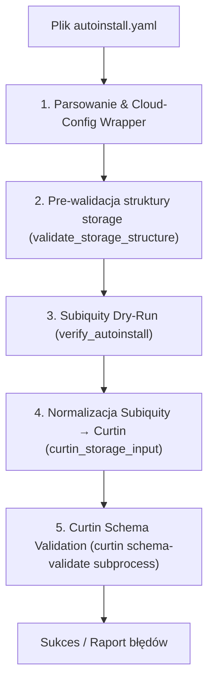

# Ubuntu Autoinstall Helper & Validator

Kompleksowy zestaw narzędzi do tworzenia, wielowarstwowej walidacji oraz instalacji automatycznych konfiguracji Ubuntu Server / Desktop (`autoinstall` / Subiquity / Curtin) na nośnikach instalacyjnych (urządzenia blokowe, pendrive'y lub pliki obrazów).

---

## Spis treści

- [Główne możliwości](#główne-możliwości)
- [Struktura projektu](#struktura-projektu)
- [Wymagania systemowe](#wymagania-systemowe)
- [Instrukcja użycia (`autoinstall-helper.py`)](#instrukcja-użycia-autoinstall-helperpy)
  - [1. Walidacja konfiguracji (`validate`)](#1-walidacja-konfiguracji-validate)
  - [2. Wgrywanie obrazu ISO (`flash`)](#2-wgrywanie-obrazu-iso-flash)
  - [3. Osadzanie konfiguracji na nośniku (`inject` / `cidata inject`)](#3-osadzanie-konfiguracji-na-nośniku-inject--cidata-inject)
  - [4. Odczyt konfiguracji z nośnika (`extract` / `cidata extract`)](#4-odczyt-konfiguracji-z-nośnika-extract--cidata-extract)
- [Architektura i warstwy walidacji](#architektura-i-warstwy-walidacji)
  - [Warstwa 1: Parsowanie i owijka cloud-config](#1-parsowanie-i-owijka-cloud-config)
  - [Warstwa 2: Strukturalna pre-walidacja storage](#2-strukturalna-pre-walidacja-storage)
  - [Warstwa 3: Subiquity dry-run](#3-subiquity-dry-run)
  - [Warstwa 4: Normalizacja Subiquity → Curtin](#4-normalizacja-subiquity--curtin)
  - [Warstwa 5: Curtin schema-validate](#5-curtin-schema-validate)
  - [Czego walidator celowo nie sprawdza ręcznie](#czego-walidator-celowo-nie-sprawdza-ręcznie)
- [Przykładowa konfiguracja autoinstall](#przykładowa-konfiguracja-autoinstall)

---

## Główne możliwości

- **Automatyczna i bezpieczna walidacja**: uruchamianie walidacji w odizolowanym środowisku kontenerowym Dockera, dopasowanym do kanału wskazanego w `autoinstall.yaml` (np. `24.04/stable`, `26.04/stable`).
- **Inteligentne rozwiązywanie wersji**: automatyczne odpytywanie Snap Store API o wersję komponentu `ubuntu-desktop-bootstrap` bez konieczności posiadania zainstalowanego `snapd`.
- **Przygotowywanie nośników**: bezpieczny zapis ISO na dysk/pendrive lub do pliku wirtualnego z automatycznym zapasem miejsca (128 MB) na partycję `cidata`.
- **Zarządzanie partycją `cidata`**: tworzenie partycji FAT32 z etykietą `cidata`, wstrzykiwanie `user-data` oraz `meta-data`, jak również ekstrakcja istniejącego pliku z nośnika.
- **Odporność na błędy GPT**: automatyczna naprawa zapasowej tablicy partycji GPT po operacji flashowania.

---

## Struktura projektu

```text
.
├── autoinstall-helper.py        # Główne narzędzie CLI do walidacji, flashowania i cidata
├── autoinstall.yaml             # Wzorcowa konfiguracja (UEFI, LUKS2 + TPM 2.0, Btrfs)
├── docker/
│   ├── Dockerfile               # Definicja kontenera z odpowiednią wersją Subiquity/Curtin
│   ├── timedatectl.sh           # Zaślepka timedatectl na potrzeby dry-run Subiquity
│   └── validate-autoinstall.py  # Skrypt walidujący działający w kontenerze
└── README.md                    # Dokumentacja projektu i architektury
```

---

## Wymagania systemowe

- **Python 3.10+** (z biblioteką `PyYAML`)
- **Docker** (wymagany do polecenia `validate`)
- **Narzędzia systemowe** (dla operacji dyskowych `flash`, `inject`, `extract`):
  - `sfdisk`, `parted`, `gdisk` / `sgdisk`
  - `mkfs.vfat` (`dosfstools`), `mtools`
  - `fallocate`, `losetup`
  - Uprawnienia administratora (`sudo`) przy operacjach na urządzeniach blokowych

---

## Instrukcja użycia (`autoinstall-helper.py`)

Narzędzie `autoinstall-helper.py` udostępnia intuicyjne podkomendy:

### 1. Walidacja konfiguracji (`validate`)

Odczytuje kanał instalatora z pliku YAML, odpytuje Snap Store API o wersję, buduje kontener Dockera (jeśli nie istnieje) i uruchamia walidację:

```bash
# Pełna walidacja domyślnego pliku autoinstall.yaml
./autoinstall-helper.py validate

# Walidacja wskazanego pliku
./autoinstall-helper.py validate /sciezka/do/custom-autoinstall.yaml

# Wybór zakresu walidacji:
#   --validation full        (domyślnie: Subiquity dry-run + Curtin schema)
#   --validation autoinstall (tylko Subiquity)
#   --validation storage     (tylko storage: struktura + Curtin schema)
./autoinstall-helper.py validate autoinstall.yaml --validation storage
```

### 2. Wgrywanie obrazu ISO (`flash`)

Zapisuje obraz instalacyjny ISO na urządzenie blokowe (np. pendrive `/dev/sdb`) lub do pliku obrazu:

```bash
# Flashowanie na pendrive (wymaga uprawnień root)
sudo ./autoinstall-helper.py flash ubuntu-24.04-desktop-amd64.iso /dev/sdb

# Flashowanie z pominięciem interaktywnego potwierdzenia
sudo ./autoinstall-helper.py flash ubuntu-24.04-desktop-amd64.iso /dev/sdb -y

# Flashowanie do pliku-obrazu (automatycznie powiększa plik o zapas na cidata)
./autoinstall-helper.py flash ubuntu-24.04-desktop-amd64.iso target.img
```

### 3. Osadzanie konfiguracji na nośniku (`inject` / `cidata inject`)

Tworzy lub aktualizuje partycję `cidata` (FAT32) na wskazanym nośniku i zapisuje konfigurację do pliku `user-data`:

```bash
# Wstrzyknięcie domyślnego autoinstall.yaml do nośnika
sudo ./autoinstall-helper.py inject /dev/sdb

# Wstrzyknięcie własnego pliku
sudo ./autoinstall-helper.py inject /dev/sdb moj-autoinstall.yaml

# Równoważne użycie grupy cidata:
sudo ./autoinstall-helper.py cidata inject /dev/sdb moj-autoinstall.yaml
```

### 4. Odczyt konfiguracji z nośnika (`extract` / `cidata extract`)

Odczytuje istniejący plik `user-data` z partycji `cidata` i zapisuje go lokalnie:

```bash
# Eksport konfiguracji z urządzenia blokowego do pliku wyjściowego
sudo ./autoinstall-helper.py extract /dev/sdb wyeksportowany.yaml

# Równoważne użycie aliasu / grupy cidata:
sudo ./autoinstall-helper.py cidata extract /dev/sdb wyeksportowany.yaml
```

---

## Architektura i warstwy walidacji

Proces weryfikacji konfiguracji autoinstall w kontenerze (`docker/validate-autoinstall.py`) opiera się na 5 wyspecjalizowanych warstwach, gwarantując pełną zgodność bez duplikowania logiki z narzędzi nadrzędnych:



### 1. Parsowanie i owijka cloud-config
- **Co robi:** Subiquity validator (`validate-autoinstall-user-data.py`) parsuje YAML i rozpakowuje sekcję `autoinstall:` z nagłówka cloud-config. Weryfikuje obecność nagłówka `#cloud-config` i klucza `autoinstall`.
- **Dlaczego:** To jedyne miejsce, gdzie format wejściowy jest sprawdzany przed wykonaniem dalszych operacji. Całość delegowana jest do Subiquity, aby wykluczyć duplikowanie logiki parsowania.

### 2. Strukturalna pre-walidacja storage (`validate_storage_structure`)
- **Co robi:** Weryfikuje wyłącznie elementarne reguły strukturalne: czy pole `storage` jest słownikiem, czy `config` jest listą, czy każda akcja jest słownikiem oraz czy identyfikatory `id` są niepuste i unikalne w obrębie całej konfiguracji.
- **Dlaczego:** `curtin schema-validate` nie sprawdza unikalności pól `id`, natomiast Subiquity przy napotkaniu zduplikowanego ID ulega awarii z nieczytelnym wyjątkiem `KeyError`. Funkcja celowo **nie zawiera list dziedzinowych** (typów akcji, dozwolonych pól czy wartości enumerowanych), co eliminuje konieczność ręcznej synchronizacji kodu ze zmianami w kolejnych wersjach Subiquity/Curtin.

### 3. Subiquity dry-run (`verify_autoinstall`)
- **Co robi:** Uruchamia Subiquity w trybie dry-run — ładuje pełną konfigurację przez oficjalną ścieżkę instalatora (`load_autoinstall_config`). Wykrywa m.in.: nieprawidłowy `layout.name`, błędne zależności między akcjami, brak punktu montowania roota (`/`), `size=-1` na nie-ostatniej partycji danego dysku oraz błędy w innych sekcjach (np. `network`, `identity`).
- **Dlaczego:** Subiquity jest autorytatywnym źródłem prawdy dla logiki instalatora. Wszelkie reguły semantyczne weryfikowane są bezpośrednio przez kod produkcyjny instalatora.

### 4. Normalizacja Subiquity → Curtin (`curtin_storage_input`)
- **Co robi:** Przekształca `storage.config` do formatu akceptowanego przez Curtin:
  - Usuwa rozszerzenie `disk.match` (wstawiając syntetyczną ścieżkę `/dev/autoinstall-match`, jeśli brak konkretnego identyfikatora urządzenia, dzięki czemu test wymaganych pól Curtina przechodzi pomyślnie).
  - Normalizuje dynamiczne rozmiary partycji (`size=-1` oraz `size=N%`) na poprawną wielkość literału (np. `"1B"`), ponieważ JSON Schema Curtina wymaga wartości `size >= 1`.
  - Uzupełnia brakujące pole `dm_crypt.dm_name` na podstawie `id` akcji, naśladując domyślne zachowanie Curtina.
- **Dlaczego:** Subiquity rozszerza składnię Curtin o własne konstrukty. Bez tej warstwy `curtin schema-validate` odrzucałby w pełni poprawne pliki konfiguracyjne Subiquity.

### 5. Curtin schema-validate (subprocess)
- **Co robi:** Wywołuje polecenie `curtin schema-validate --storage --config <plik>` na znormalizowanym YAML-u. Curtin waliduje każdą akcję w oparciu o rygorystyczny JSON Schema (`additionalProperties: false`) — natychmiast wyłapując literówki, nieznane pola, niedozwolone typy wartości czy brakujące wymagane atrybuty.
- **Dlaczego:** Curtin stanowi autorytatywne źródło reguł dla konfiguracji dyskowych. Uruchomienie go jako procesu potomnego (subprocess) zamiast importowania wewnętrznych modułów Pythona izoluje walidator od prywatnych zmian w API i zapewnia pełną spójność z wersją instalatora.

### Czego walidator celowo nie sprawdza ręcznie

Subiquity celowo **ignoruje nieznane typy akcji oraz nieznane pola** (dla zachowania kompatybilności wstecznej i w przód). Warstwa `curtin schema-validate` wyłapuje te anomalie po normalizacji. Nasz kod nie powiela ani nie narzuca sztywnych list dozwolonych wartości, co zabezpiecza go przed przeterminowaniem przy aktualizacjach pakietów Ubuntu.

---

## Przykładowa konfiguracja autoinstall

W repozytorium znajduje się wzorcowy plik `autoinstall.yaml` skonfigurowany pod kątem nowoczesnych stacji roboczych:

- **Aktualizacja instalatora:** kanał `26.04/stable` (lub `24.04/stable`) z `refresh-installer: update: true`.
- **Partycjonowanie UEFI + GPT:** partycja `/boot/efi` o rozmiarze 1 GB.
- **Pełne szyfrowanie LUKS2 sprzężone z TPM 2.0:** automatyczne odblokowywanie kluczem sprzętowym TPM.
- **System plików Btrfs:**
  - Podwolumen `@` zamontowany w `/` z kompresją `zstd:1` oraz `discard=async`.
  - Podwolumen `@home` zamontowany w `/home` z kompresją `zstd:1`.
- **Sekcje interaktywne:** `interactive-sections: [identity]` – możliwość bezpiecznego podania użytkownika i hasła podczas instalacji.
- **Sterowniki i kodeki:** automatyczna instalacja własnościowych sterowników i multimediów.
