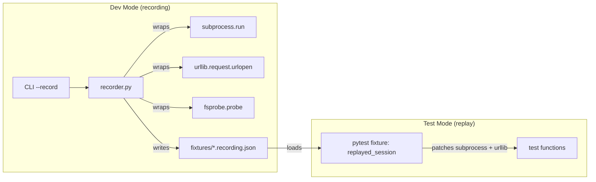
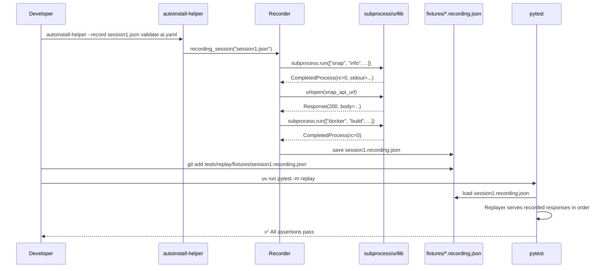

# Dev Mode: Interaction Recording & Replay

> [!IMPORTANT]
> Design for a `--record` dev mode that captures all subprocess and network interactions, saves them to committable JSON fixtures, and replays them in tests.

## Problem

The tool has ~25 `subprocess.run` call sites (`losetup`, `parted`, `blkid`, `dd`, `docker`, `sgdisk`, `virsh`, …) plus the `vm` group that fans out over `virsh`/`qemu-img`/`virt-install`, a handful of filesystem metadata probes (existence/type/size of the ISO, target, and config), and 2 network endpoints (Snap Store API, GitHub raw). Today, tests mock these by hand with `monkeypatch.setattr`. There's no way to:
- Capture a **real session** and turn it into a test fixture automatically
- Reproduce exact tool behavior without manual mock construction
- Detect regressions from changed subprocess output formats

## Architecture



## Recording Format

Each session produces a single `.recording.json` file:

```json
{
  "metadata": {
    "schema_version": 1,
    "recorded_at": "2026-11-09T19:30:00.000000+00:00",
    "argv": ["autoinstall-helper", "validate", "autoinstall.yaml"],
    "python": "3.12.3",
    "kernel": "Linux-6.8.0-generic-x86_64",
    "os_release": {
      "ID": "ubuntu",
      "VERSION_ID": "25.10",
      "VERSION_CODENAME": "questing",
      "PRETTY_NAME": "Ubuntu 25.10"
    },
    "exit_code": 0
  },
  "interactions": [
    {
      "seq": 0,
      "type": "subprocess",
      "timestamp": "2026-11-09T19:30:01.123+00:00",
      "command": ["snap", "info", "ubuntu-desktop-bootstrap"],
      "cwd": null,
      "env_diff": null,
      "text": true,
      "result": {
        "returncode": 0,
        "stdout": "name: ubuntu-desktop-bootstrap\nchannel: ...",
        "stderr": ""
      },
      "error": null,
      "duration_ms": 245
    },
    {
      "seq": 1,
      "type": "urlopen",
      "timestamp": "2026-11-09T19:30:01.400+00:00",
      "url": "https://api.snapcraft.io/v2/snaps/info/ubuntu-desktop-bootstrap",
      "method": "GET",
      "request_headers": {"Snap-Device-Series": "16"},
      "result": {
        "status": 200,
        "body": "{\"channel-map\": [...]}",
        "response_headers": {"Content-Type": "application/json"}
      },
      "error": null,
      "duration_ms": 312
    },
    {
      "seq": 2,
      "type": "fs",
      "timestamp": "2026-11-09T19:30:01.500+00:00",
      "op": "probe",
      "path": "/data/ubuntu-desktop-bootstrap-24.04.iso",
      "result": {
        "exists": true,
        "is_file": true,
        "is_dir": false,
        "is_block": false,
        "size": 4617089843
      }
    }
  ]
}
```

`result` is `null` when a subprocess/urlopen call raised; `error` then carries the exception details (type, message, and — for `HTTPError`/`CalledProcessError` — `code`/`headers`/`returncode`). Replay re-raises the recorded exception, so error-handling branches stay under test.

> [!NOTE]
> `kernel` is the `platform.platform()` string (OS family + kernel, e.g. `Linux-6.8.0-generic-x86_64`) and `os_release` holds the fields of `/etc/os-release` read with `platform.freedesktop_os_release()` — the stdlib equivalent of `lsb_release -a`. That records the **distribution release** (Ubuntu 25.10 "questing"), not just the kernel, which matters because tool output and versions are distro-specific. Recordings are environment-specific: this metadata documents where a session came from and can be asserted in replay via `replayer.metadata["os_release"]["VERSION_ID"]`.

> [!NOTE]
> Every subprocess call that **captures** output uses `text=True`, so captured `stdout`/`stderr` are stored and replayed as plain UTF-8 strings, keeping fixtures human-readable and clean in `git diff`.
> Calls that do **not** capture output (`chattr`, `sync`, `fallocate`, the bare `udevadm settle`/`partprobe`, `docker build`, `docker run`, `dd`) record `null` for the missing stream, and the replayer returns `None` — exactly like the real `subprocess.run`.
> The recorder decodes bytes defensively (and the replayer re-encodes when the caller did not request text), so a future call that forgets `text=True` cannot corrupt a fixture.

> [!WARNING]
> Disk images, ISOs, and target block devices (`dd of=...`) are NEVER recorded — only the process exit code and its console messages are captured. Today `dd` (`flash.py`) and `docker build`/`docker run` (`docker_utils.py`) run **without** capturing stdout/stderr, so their console output — including `dd` progress and the entire validator report — is **not** recorded. To make a `flash` or `validate` recording useful, those call sites must pass `capture_output=True` (or the container output must be logged explicitly). Until then, recordings of `validate` only capture subprocess exit codes, not the messages the user sees.

## Module: `src/autoinstall_helper/interactions.py`

Small shared helpers used by both the recorder and the replayer. Zero external dependencies (stdlib only).

```python
"""Shared helpers for recording and replaying external interactions."""

from __future__ import annotations

import urllib.request
from typing import Any


class FakeResponse:
    """Minimal stand-in for the object returned by ``urllib.request.urlopen``."""

    def __init__(self, body: bytes, status: int, headers: dict[str, str]) -> None:
        self._body = body
        self.status = status
        self.code = status
        self.headers = headers

    def read(self) -> bytes:
        return self._body

    def geturl(self) -> str:
        return ""

    def close(self) -> None:
        pass

    def __enter__(self) -> FakeResponse:
        return self

    def __exit__(self, *exc: object) -> bool:
        return False


def extract_url(url_or_req: Any) -> str:
    """Return the target URL for either a plain URL string or a Request."""
    if isinstance(url_or_req, urllib.request.Request):
        return url_or_req.full_url
    return str(url_or_req)


def extract_method(url_or_req: Any) -> str:
    """Return the HTTP method (Request defaults to GET when unset)."""
    if isinstance(url_or_req, urllib.request.Request):
        return url_or_req.get_method() or "GET"
    return "GET"


def extract_headers(url_or_req: Any) -> dict[str, str]:
    """Return the request headers (empty for a plain URL string)."""
    if isinstance(url_or_req, urllib.request.Request):
        return dict(url_or_req.header_items())
    return {}


def decode(data: bytes | str | None) -> str | None:
    """Return text for recorded output, decoding bytes defensively."""
    if data is None:
        return None
    if isinstance(data, bytes):
        return data.decode("utf-8", errors="replace")
    return data
```

## Module: `src/autoinstall_helper/fsprobe.py`

A thin seam over filesystem **metadata**. Production code must resolve path metadata through `fsprobe.probe()` instead of calling `Path.exists`/`Path.is_file`/`Path.stat` directly, so the recorder can journal the results. Only metadata is ever captured — never file contents — so ISOs, disk images, and block devices are never copied into fixtures.

```python
"""Thin filesystem seam so dev-mode recording can capture path metadata.

Production code resolves path metadata through :func:`probe` so the recorder can
journal it. Only metadata is captured (existence, type, size) — never contents.
"""

from __future__ import annotations

import stat
from pathlib import Path
from typing import NamedTuple


class PathInfo(NamedTuple):
    """Metadata about a path, as captured by :func:`probe`."""

    exists: bool
    is_file: bool
    is_dir: bool
    is_block: bool
    size: int


def probe(path: Path) -> PathInfo:
    """Return the metadata a recording needs to reproduce a path probe."""
    try:
        st = path.stat()
    except OSError:
        return PathInfo(exists=False, is_file=False, is_dir=False, is_block=False, size=0)
    return PathInfo(
        exists=True,
        is_file=stat.S_ISREG(st.st_mode),
        is_dir=stat.S_ISDIR(st.st_mode),
        is_block=stat.S_ISBLK(st.st_mode),
        size=st.st_size,
    )
```

### Filesystem media rule

- **Metadata only, never contents.** `probe()` records `exists`/`is_file`/`is_dir`/`is_block`/`size`; it never opens, reads, or copies a file. A 4.5 GB ISO becomes five small scalars in the fixture.
- **Large media are safe by construction.** `dd if=<iso> of=<target>` and any large write stay ordinary replayed `subprocess` interactions (exit code only). No disk image, ISO, or block device is ever persisted.
- **Small text files stay real fixtures.** `autoinstall.yaml` and the tool's own `docker/` assets are not intercepted; tests provide the small files they need (or reuse committed ones). Reads of small text are intentionally left outside the seam.
- **Never patch `pathlib`/`os` globally.** Unlike `subprocess`, the recorder shares the filesystem with the code under test: `Recorder.save()` writes the JSON fixture, `get_docker_digest()` reads repo assets, `get_docker_dir()` extracts to a temp dir. A global `Path.stat`/`open` patch would intercept the recorder itself. The explicit seam is the only safe interception point.

### Migration (call sites routed through `fsprobe.probe`)

| Site | From | To |
|------|------|----|
| `flash.py:35,36,86,88` | `target.exists()`, `target.stat().st_size` | `fsprobe.probe(target).exists` / `.size` |
| `flash.py:57,59,62` | `iso_path.exists()/is_file()/stat().st_size` | `fsprobe.probe(iso_path)` fields |
| `cidata.py:58,293,297,330,332,338` | `target/yaml_path.exists()/is_file()/is_dir()` | `fsprobe.probe(...)` fields |
| `disk.py:11` | `path.stat().st_mode & 0o170000 == 0o060000` | `fsprobe.probe(path).is_block` |
| `cli.py:61,77` | `config_file.exists()`, `dockerfile.exists()` | `fsprobe.probe(...).exists` |
| `vm.py:475,482` | `media.exists()/is_file()` | `fsprobe.probe(media)` fields |

> [!TIP]
> Use `from autoinstall_helper import fsprobe` and call `fsprobe.probe(...)` (attribute lookup at call time) so the recorder/replayer can patch the seam. `shutil.which(...)` (PATH probes in `disk.py:24`, `snapstore.py:59`, `vm.py:96,107,710,806`) is a separate concern and stays environment-dependent.

## Module: `src/autoinstall_helper/recorder.py`

Zero external dependencies (stdlib only: `json`, `os`, `platform`, `subprocess`, `sys`, `time`, `urllib.request`).

### Core API

```python
"""Record subprocess/network/filesystem interactions for dev-mode testing."""

from __future__ import annotations

import json
import os
import platform
import subprocess
import sys
import time
import urllib.error
import urllib.request
from collections.abc import Iterator
from contextlib import contextmanager
from datetime import datetime, timezone
from pathlib import Path
from typing import Any

from autoinstall_helper import fsprobe
from autoinstall_helper.fsprobe import PathInfo
from autoinstall_helper.interactions import (
    FakeResponse,
    decode,
    extract_headers,
    extract_method,
    extract_url,
)

SCHEMA_VERSION = 1

# Environment variable names whose *values* are never written to a recording.
SENSITIVE_ENV_MARKERS = ("TOKEN", "SECRET", "PASSWORD", "PASSWD", "CREDENTIAL", "API_KEY", "APIKEY")


def _now() -> str:
    """Return the current UTC time as an ISO-8601 string."""
    return datetime.now(timezone.utc).isoformat(timespec="milliseconds")


def _os_release() -> dict[str, str]:
    """Return the /etc/os-release fields (distribution, version, codename).

    Uses the stdlib equivalent of ``lsb_release -a`` (Python >= 3.10), so a
    recording captures the distro release (e.g. Ubuntu 25.10 "questing") and not
    just the kernel reported by ``platform.platform()``.
    """
    try:
        return dict(platform.freedesktop_os_release())
    except OSError:
        return {}


def _env_diff(env: dict[str, str] | None) -> dict[str, str] | None:
    """Return the environment keys that differ from the current process, with secrets redacted."""
    if env is None or env is os.environ:
        return None
    diff = {key: value for key, value in env.items() if os.environ.get(key) != value}
    if not diff:
        return None
    return {
        key: ("<redacted>" if any(marker in key.upper() for marker in SENSITIVE_ENV_MARKERS) else value)
        for key, value in diff.items()
    }


def _describe_error(exc: BaseException) -> dict[str, Any]:
    """Capture just enough of an exception to reconstruct it during replay."""
    info: dict[str, Any] = {"type": type(exc).__name__, "message": str(exc)}
    if isinstance(exc, urllib.error.HTTPError):
        info["code"] = exc.code
        info["headers"] = dict(exc.headers or {})
    if isinstance(exc, subprocess.CalledProcessError):
        info["returncode"] = exc.returncode
    return info


class Recorder:
    """Accumulates interactions and writes them to a JSON file."""

    def __init__(self, output_path: Path) -> None:
        self._path = output_path
        self._interactions: list[dict[str, Any]] = []
        self._seq = 0
        self._original_subprocess_run: Any = None
        self._original_urlopen: Any = None
        self._original_probe: Any = None
        self.exit_code: int | None = None

    # -- recording --------------------------------------------------------

    def _record(self, entry: dict[str, Any]) -> None:
        entry["seq"] = self._seq
        self._seq += 1
        self._interactions.append(entry)

    def _wrap_subprocess_run(self, cmd, /, **kwargs):
        """Call the real ``subprocess.run``, record the interaction, return it unchanged."""
        captured = bool(
            kwargs.get("capture_output") or kwargs.get("stdout") is not None or kwargs.get("stderr") is not None
        )
        entry: dict[str, Any] = {
            "type": "subprocess",
            "timestamp": _now(),
            "command": list(map(str, cmd)),
            "cwd": str(kwargs["cwd"]) if kwargs.get("cwd") is not None else None,
            "env_diff": _env_diff(kwargs.get("env")),
            "text": bool(kwargs.get("text") or kwargs.get("universal_newlines")),
        }
        start = time.monotonic()
        try:
            result = self._original_subprocess_run(cmd, **kwargs)
        except BaseException as exc:
            entry["duration_ms"] = round((time.monotonic() - start) * 1000)
            entry["result"] = None
            entry["error"] = _describe_error(exc)
            self._record(entry)
            raise
        entry["duration_ms"] = round((time.monotonic() - start) * 1000)
        entry["result"] = {
            "returncode": result.returncode,
            "stdout": decode(result.stdout) if captured else None,
            "stderr": decode(result.stderr) if captured else None,
        }
        entry["error"] = None
        self._record(entry)
        return result

    def _wrap_urlopen(self, url_or_req, /, **kwargs):
        """Call the real ``urllib.request.urlopen``, record the interaction, return a replayable response."""
        entry: dict[str, Any] = {
            "type": "urlopen",
            "timestamp": _now(),
            "url": extract_url(url_or_req),
            "method": extract_method(url_or_req),
            "request_headers": extract_headers(url_or_req),
        }
        start = time.monotonic()
        try:
            response = self._original_urlopen(url_or_req, **kwargs)
            body = response.read()
            status = response.status
            headers = dict(response.headers)
        except BaseException as exc:
            entry["duration_ms"] = round((time.monotonic() - start) * 1000)
            entry["result"] = None
            entry["error"] = _describe_error(exc)
            self._record(entry)
            raise
        entry["duration_ms"] = round((time.monotonic() - start) * 1000)
        entry["result"] = {
            "status": status,
            "body": decode(body) or "",
            "response_headers": headers,
        }
        entry["error"] = None
        self._record(entry)
        response.close()
        return FakeResponse(body, status, headers)

    def _wrap_probe(self, path: Path) -> PathInfo:
        """Probe real filesystem metadata, record it, and return it unchanged."""
        info = self._original_probe(path)
        self._record(
            {
                "type": "fs",
                "timestamp": _now(),
                "op": "probe",
                "path": str(path),
                "result": dict(info._asdict()),
            }
        )
        return info

    # -- patch lifecycle --------------------------------------------------

    def patch(self) -> None:
        """Monkey-patch subprocess.run, urllib.request.urlopen and fsprobe.probe (idempotent)."""
        if self._original_subprocess_run is None:
            self._original_subprocess_run = subprocess.run
            self._original_urlopen = urllib.request.urlopen
            self._original_probe = fsprobe.probe
        subprocess.run = self._wrap_subprocess_run
        urllib.request.urlopen = self._wrap_urlopen
        fsprobe.probe = self._wrap_probe

    def unpatch(self) -> None:
        """Restore the originals captured by the first :meth:`patch`."""
        if self._original_subprocess_run is not None:
            subprocess.run = self._original_subprocess_run
            urllib.request.urlopen = self._original_urlopen
            fsprobe.probe = self._original_probe
            self._original_subprocess_run = None
            self._original_urlopen = None
            self._original_probe = None

    # -- persistence ------------------------------------------------------

    def save(self) -> Path:
        """Write accumulated interactions to the JSON file."""
        data = {
            "metadata": {
                "schema_version": SCHEMA_VERSION,
                "recorded_at": datetime.now(timezone.utc).isoformat(),
                "argv": sys.argv[:],
                "python": platform.python_version(),
                "kernel": platform.platform(),
                "os_release": _os_release(),
                "exit_code": self.exit_code,
            },
            "interactions": self._interactions,
        }
        self._path.parent.mkdir(parents=True, exist_ok=True)
        self._path.write_text(json.dumps(data, indent=2, ensure_ascii=False), encoding="utf-8")
        return self._path


@contextmanager
def recording_session(output_path: Path | str) -> Iterator[Recorder]:
    """Context manager: patch, yield the recorder, and save on exit."""
    rec = Recorder(Path(output_path))
    rec.patch()
    try:
        yield rec
    finally:
        rec.unpatch()
        saved = rec.save()
        print(f"[autoinstall-helper] Session recorded to {saved}", file=sys.stderr)
```

### Why monkey-patch globally?

Every module (`cidata`, `disk`, `docker_utils`, `flash`, `snapstore`, `vm`) does `import subprocess` and dereferences `subprocess.run` at call time. Because they all share the **same** `subprocess` module object, patching `subprocess.run` at the source covers all call sites at once — including modules added later. This is also why the per-module loop in the original fixture sketch was redundant and could silently miss `vm`. The same applies to `urllib.request.urlopen` (only `snapstore` uses it today) and to `fsprobe.probe`, which is the single seam for filesystem metadata.

> [!WARNING]
> The global patch is only active inside the `recording_session()` context manager and must never be left active in production. `--record` is a dev-only flag; the recorder/replayer add no runtime behavior on the normal code path.

## Module: `src/autoinstall_helper/replayer.py`

Replay engine for tests — loads a `.recording.json` and serves recorded responses, reproducing both successful results and recorded exceptions.

```python
"""Replay recorded interactions for deterministic testing."""

from __future__ import annotations

import json
import subprocess
import urllib.error
import warnings
from pathlib import Path
from typing import Any

from autoinstall_helper.fsprobe import PathInfo
from autoinstall_helper.interactions import FakeResponse, extract_url


class ReplayError(Exception):
    """Raised when replay encounters an unexpected or unmapped interaction."""


class Replayer:
    """Serves recorded interactions, matching by command/URL with ordered fallback."""

    def __init__(self, recording_path: Path) -> None:
        data = json.loads(recording_path.read_text(encoding="utf-8"))
        self.metadata = data["metadata"]
        self._interactions: list[dict[str, Any]] = data["interactions"]
        self._consumed: set[int] = set()

    # -- lookup -----------------------------------------------------------

    @staticmethod
    def _key_of(entry: dict[str, Any]) -> str | None:
        if entry["type"] == "subprocess":
            return "\x00".join(entry.get("command", []))
        if entry["type"] == "urlopen":
            return entry.get("url")
        if entry["type"] == "fs":
            return entry.get("path")
        return None

    def _take(self, kind: str, key: str | None) -> dict[str, Any]:
        for index, entry in enumerate(self._interactions):
            if index not in self._consumed and entry["type"] == kind and self._key_of(entry) == key:
                self._consumed.add(index)
                return entry
        # Desync recovery: fall back to the next unconsumed entry of the same kind.
        for index, entry in enumerate(self._interactions):
            if index not in self._consumed and entry["type"] == kind:
                warnings.warn(
                    f"Replay mismatch: no record for {kind} {key!r}; using seq={index} ({self._key_of(entry)!r})",
                    stacklevel=3,
                )
                self._consumed.add(index)
                return entry
        raise ReplayError(f"No recorded {kind} interaction left (requested {key!r})")

    def _raise_recorded_error(self, entry: dict[str, Any], *, kind: str) -> None:
        error = entry.get("error")
        if not error:
            return
        name = error.get("type", "")
        message = error.get("message", "")
        if name == "CalledProcessError":
            raise subprocess.CalledProcessError(error.get("returncode", 1), entry.get("command"), output=None)
        if name == "HTTPError":
            raise urllib.error.HTTPError(
                entry.get("url", ""), error.get("code", 0), message, error.get("headers", {}), None
            )
        if name == "URLError":
            raise urllib.error.URLError(message)
        if name == "FileNotFoundError":
            raise FileNotFoundError(message)
        if name == "TimeoutExpired":
            raise subprocess.TimeoutExpired(entry.get("command"), error.get("timeout"))
        raise ReplayError(f"Recorded {kind} error {name!r} cannot be reconstructed faithfully: {message}")

    # -- serving ----------------------------------------------------------

    def next_subprocess(self, cmd, /, **kwargs):
        """Return the recorded subprocess result (or re-raise the recorded error)."""
        entry = self._take("subprocess", "\x00".join(map(str, cmd)))
        self._raise_recorded_error(entry, kind="subprocess")

        result = entry.get("result") or {}
        returncode = result.get("returncode", 0)
        text_mode = bool(kwargs.get("text") or kwargs.get("universal_newlines"))
        stdout = result.get("stdout")
        stderr = result.get("stderr")
        if stdout is not None and not text_mode:
            stdout = stdout.encode("utf-8")
        if stderr is not None and not text_mode:
            stderr = stderr.encode("utf-8")

        if kwargs.get("check") and returncode != 0:
            raise subprocess.CalledProcessError(returncode, list(cmd), output=stdout, stderr=stderr)
        return subprocess.CompletedProcess(list(cmd), returncode, stdout, stderr)

    def next_urlopen(self, url_or_req, /, **kwargs):
        """Return the recorded urllib response (or re-raise the recorded error)."""
        entry = self._take("urlopen", extract_url(url_or_req))
        self._raise_recorded_error(entry, kind="urlopen")

        result = entry.get("result") or {}
        return FakeResponse(
            body=result.get("body", "").encode("utf-8"),
            status=result.get("status", 200),
            headers=result.get("response_headers", {}),
        )

    def next_probe(self, path: Path) -> PathInfo:
        """Return the recorded filesystem metadata for ``path``."""
        entry = self._take("fs", str(path))
        self._raise_recorded_error(entry, kind="fs")
        return PathInfo(**entry["result"])

    def assert_exhausted(self) -> None:
        """Assert every recorded interaction was replayed."""
        remaining = [i for i in range(len(self._interactions)) if i not in self._consumed]
        if remaining:
            details = ", ".join(f"seq={i}({self._interactions[i]['type']})" for i in remaining)
            raise ReplayError(f"{len(remaining)} recorded interactions were not replayed: {details}")
```

## Test Groups

The suite is split into three tiers, so the default `uv run pytest` stays fast and truly unit-level:

| Group | Location | Marker | Runs by default | Requires |
|-------|----------|--------|-----------------|----------|
| Unit | `tests/test_*.py` | — | yes | nothing (boundaries mocked at point of use) |
| Component (recorded replay) | `tests/replay/` | `replay` | no (`-m replay`) | committed recordings only — no Docker, network, or devices |
| Smoke (end-to-end artifact) | `tests/smoke/` | `smoke` | no (`-m smoke`) | built `.pyz`, Docker, network, libvirt |

Recorded-replay tests are conceptually *component* (or *contract*) tests: they drive a real command flow (`flash`, `cidata`, `validate`, …) but every external boundary — `subprocess`, `urllib`, filesystem metadata — is served from a recording, so they are hermetic and deterministic. The marker name `replay` describes the mechanism; the directory makes the tier explicit, exactly like `tests/smoke/`.

```bash
uv run pytest                    # unit only
uv run pytest -m replay          # component tests (recorded replay)
uv run pytest -m smoke           # end-to-end artifact tests
uv run pytest -m 'not smoke'     # unit + component
```

### Fixture: `tests/replay/conftest.py`

```python
"""Fixtures for recorded-replay component tests (tests/replay/)."""

import subprocess
import urllib.request
from pathlib import Path

import pytest

from autoinstall_helper import fsprobe
from autoinstall_helper.replayer import Replayer

FIXTURES_DIR = Path(__file__).parent / "fixtures"


@pytest.fixture
def replayed_session(request, monkeypatch):
    """Replay tests/replay/fixtures/<name>.recording.json for one test.

    The recording is selected with indirect parametrization:

        @pytest.mark.parametrize("replayed_session", ["flash-existing-target"], indirect=True)
        def test_flash_existing_target(replayed_session):
            ...  # subprocess/urllib/fsprobe calls return recorded data
    """
    name = request.param
    path = FIXTURES_DIR / f"{name}.recording.json"
    if not path.exists():
        pytest.fail(f"Recording fixture not found: {path}")

    replayer = Replayer(path)

    # All modules share the same objects, so one patch per boundary is enough
    # (subprocess: cidata, disk, docker_utils, flash, snapstore, vm;
    # fsprobe: flash, cidata, disk, cli, vm).
    monkeypatch.setattr(subprocess, "run", replayer.next_subprocess)
    monkeypatch.setattr(urllib.request, "urlopen", replayer.next_urlopen)
    monkeypatch.setattr(fsprobe, "probe", replayer.next_probe)

    yield replayer

    replayer.assert_exhausted()
```

### Example component test: `tests/replay/test_flash.py`

```python
"""Recorded-replay component tests for the 'flash' command."""

import pytest

from autoinstall_helper import flash

pytestmark = pytest.mark.replay


@pytest.mark.parametrize("replayed_session", ["flash-existing-target"], indirect=True)
def test_flash_existing_target(replayed_session, tmp_path):
    # No ISO, no device: size/existence come from the recording via fsprobe.probe,
    # and dd/fallocate/chattr are replayed subprocess results.
    iso = tmp_path / "respin.iso"
    target = tmp_path / "target.img"

    assert flash.flash(iso, target, yes=True) == 0
```

### Pytest configuration: `pyproject.toml`

```toml
[tool.pytest.ini_options]
markers = [
    "smoke: end-to-end tests against the built .pyz artifact (require Docker and network)",
    "replay: component tests that replay tests/replay/fixtures/*.recording.json",
]
# Default run is pure unit tests; both the artifact smoke tests and the
# recorded-replay component tests only run when explicitly requested.
addopts = "-m 'not smoke and not replay'"
```

> [!NOTE]
> Replay tests are hermetic (no Docker/network), so CI should run them as a separate step (`uv run pytest -m replay -v`) next to the default unit run — they gate merges without the cost or flakiness of `smoke`. Update the `Tests` section of `AGENTS.md` and `.github/workflows/ci.yml` accordingly when this lands.

## CLI Integration

Add a `--record` flag to the top-level parser in `cli.py` and wrap dispatching in `recording_session`. The flag is registered only when running from source (`is_packaged_zipapp()` is `False`), so the packaged `.pyz` never exposes the recording capability:

```python
# In build_parser():
if not is_packaged_zipapp():
    parser.add_argument(
        "--record",
        metavar="FILE",
        default=None,
        help="Dev mode: record all subprocess/network interactions to FILE (pass before COMMAND)",
    )


# In main():
def main(argv: list[str] | None = None) -> int:
    parser = build_parser()
    args = parser.parse_args(argv)
    if args.record:
        from autoinstall_helper.recorder import recording_session

        with recording_session(args.record) as rec:
            rc = dispatch(args, parser)
            rec.exit_code = rc
        return rc
    return dispatch(args, parser)
```

> [!NOTE]
> Because `--record` is a top-level option, it must precede the subcommand: `autoinstall-helper --record session.json validate ai.yaml`. The wrapper must call `dispatch(args, parser)` (the real function in `cli.py`), not a `_dispatch_command` helper.

## Workflow



## File Layout

```
src/autoinstall_helper/
├── interactions.py      # NEW — Shared fake response + extraction helpers
├── fsprobe.py           # NEW — Filesystem metadata seam (never records contents)
├── recorder.py          # NEW — Recording engine (dev mode; excluded from the .pyz)
├── replayer.py          # NEW — Replay engine for tests (excluded from the .pyz)
├── cli.py               # MODIFIED — --record flag + probe-based exists() checks
├── flash.py             # MODIFIED — route ISO/target metadata through fsprobe.probe
├── cidata.py            # MODIFIED — route target/yaml metadata through fsprobe.probe
├── disk.py              # MODIFIED — is_block_device() uses fsprobe.probe
├── vm.py                # MODIFIED — route media metadata through fsprobe.probe
└── ...

tests/
├── test_*.py            # UNCHANGED — unit tests (default run)
├── replay/              # NEW — component tests (recorded replay, marker: replay)
│   ├── conftest.py      #   replayed_session fixture
│   ├── test_flash.py
│   ├── test_cidata.py
│   ├── test_validate.py
│   └── fixtures/        #   committed recordings
│       ├── flash-existing-target.recording.json
│       ├── validate-basic.recording.json
│       └── ...
└── smoke/               # UNCHANGED — end-to-end artifact tests (marker: smoke)

pyproject.toml           # MODIFIED — register the `replay` marker + exclude it from the default run
AGENTS.md                # MODIFIED — document the replay/component tier (on implementation)
.github/workflows/ci.yml # MODIFIED — run `pytest -m replay` as a separate CI step (on implementation)
```

> `interactions.py`, `recorder.py`, `replayer.py` and `build.py` are dev-only: `build.py`'s archive
> filter drops them from the `.pyz`, and `is_packaged_zipapp()` hides the `--record` flag there.

## Design Decisions

| Decision | Choice | Rationale |
|----------|--------|-----------|
| Interception mechanism | Global `subprocess.run` patch | All modules share the same `subprocess` object, so one patch catches every call site (including `vm`) without touching existing code |
| Recording format | JSON, `schema_version`-tagged | Human-readable, diffable, committable, stdlib-only; the version allows format evolution |
| Environment metadata | `kernel` + `os_release` (`platform.freedesktop_os_release`) | Captures the distro release (Ubuntu 25.10 "questing"), not just the kernel, since tool output and versions are distro-specific |
| Output stream handling | UTF-8 strings when captured, `null` otherwise | All capturing calls use `text=True`; uncaptured streams stay `None` like the real API. Bytes are decoded defensively so a missing `text=True` cannot corrupt a fixture |
| Exception fidelity | Record `error` and re-raise on replay | `CalledProcessError`/`HTTPError` branches (`snapstore` 404 fallback, `check=True`) must stay under test instead of silently taking a different path |
| `check=True` semantics | Reproduced by the replayer | A nonzero recorded `returncode` with `check=True` raises `CalledProcessError`, matching real behavior |
| Replay matching | By `(type, command/url/path)` with ordered fallback | Robust to environment-dependent branch changes (e.g. missing `snap`); a mismatch warns loudly instead of silently desynchronizing |
| Sanitization | Always on (env redaction, committed fixtures reviewed) | `lsblk`/`blkid`/`virsh`/`parted` output and absolute paths end up in committed JSON; secret-looking env vars are redacted |
| Filesystem boundary | Explicit `fsprobe.probe()` seam, metadata only | Global `pathlib`/`os` patching would intercept the recorder's own fixture write and asset reads; contents of large, binary, or device files are never captured |
| Large media | Metadata (`size`) only; `dd` replayed by exit code | ISOs, images, and block devices never enter fixtures — a 4.5 GB ISO becomes five scalars, and replay needs no ISO file |
| Test tiers | Unit (default) / `replay` (component) / `smoke` (artifact) | Keeps the default `pytest` truly unit-level; recorded replay is hermetic and runs in CI as a separate step; smoke stays opt-in like today |
| Replay fixture scope | `tests/replay/conftest.py`, indirect-parametrized | Local to the tier and mirrors the `tests/smoke/` layout; the recording is selected per test without a second marker |
| Scope | Context manager | Prevents accidental leak of patches into production |
| Dependencies | Zero (stdlib only) | Complies with AGENTS.md zero-dependency rule |

## Known Limitations

- **Uncaptured output is not recorded.** `dd`, `docker build`, `docker run`, `chattr`, `sync`, `fallocate`, `udevadm settle`, `partprobe` run without `capture_output`, so only their exit codes are captured. Recording `validate`/`flash` for assertion purposes requires changing those call sites.
- **Only metadata probes are journaled.** Paths that go through `fsprobe.probe` replay without the file existing — a replayed `flash` needs **no ISO**, only the recorded `size`. Paths not routed through the seam (small YAML reads via `config.py`, the tool's own `docker/` assets, `shutil.which`) still require the real file or binary.
- **Writes and real file contents are not intercepted.** `shutil.copy2`/`Path.touch`/`tempfile.mkdtemp` run for real during replay, and small `autoinstall.yaml` fixtures must exist. Only large/binary/device files are excluded, and by design: contents are never recorded.
- **Environment-dependent branches.** `shutil.which("snap")`, `shutil.which("sgdisk")`, and platform detection decide whether some calls happen at all. Recording captures one such path; fixtures are distro/kernel-specific (see `metadata.os_release`) and must be regenerated if the branch changes. Replay does not enforce the environment — the metadata is informational.
- **Locale-dependent decoding.** `text=True` uses the locale encoding; a call that ingests non-ASCII output under `LC_ALL=C` can raise `UnicodeDecodeError`. Prefer `encoding="utf-8", errors="replace"` in new call sites.

## Open Questions

1. **Should `--record` require `--yes` to skip interactive prompts?** Recording works best for fully non-interactive runs (`flash` prompts via `input()`).
2. **Should replay support fuzzy matching for paths?** E.g. ignore `/tmp` vs `/tmp/pytest-*` differences; today a mismatch warns and falls back to order.
3. **Should fixtures cap large outputs?** `parted`/`lsblk`/Curtin reports can be long; an optional truncation flag would keep fixtures small.
4. **Environment variable alternative?** `AUTOINSTALL_HELPER_RECORD=path.json` instead of / in addition to `--record` — useful for recording through wrapper scripts.
