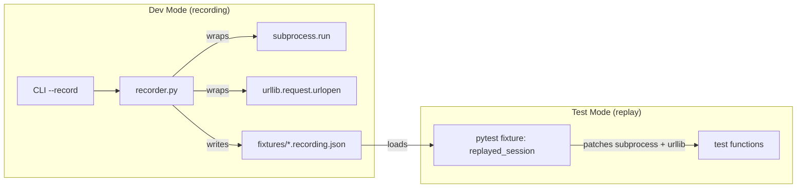
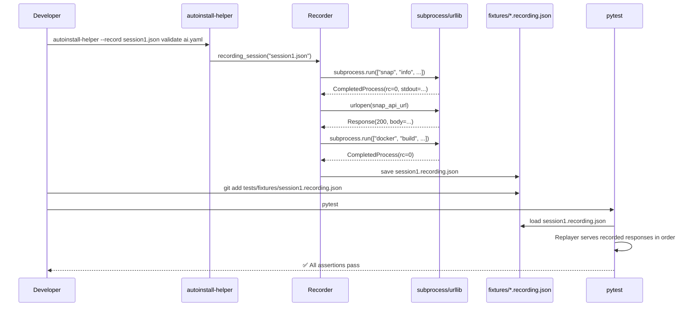

# Dev Mode: Interaction Recording & Replay

> [!IMPORTANT]
> Design for a `--record` dev mode that captures all subprocess and network interactions, saves them to committable JSON fixtures, and replays them in tests.

## Problem

The tool calls ~32 subprocess commands (`losetup`, `parted`, `blkid`, `dd`, `docker`, `sgdisk`, …) and 2 network endpoints (Snap Store API, GitHub raw). Today, tests mock these by hand with `monkeypatch.setattr`. There's no way to:
- Capture a **real session** and turn it into a test fixture automatically
- Reproduce exact tool behavior without manual mock construction
- Detect regressions from changed subprocess output formats

## Architecture



## Recording Format

Each session produces a single `.recording.json` file:

```json
{
  "metadata": {
    "recorded_at": "2026-11-09T20:30:00+01:00",
    "argv": ["autoinstall-helper", "validate", "autoinstall.yaml"],
    "python": "3.12.3",
    "platform": "Linux-6.8.0-generic-x86_64"
  },
  "interactions": [
    {
      "seq": 0,
      "type": "subprocess",
      "timestamp": "2026-11-09T20:30:01.123Z",
      "command": ["snap", "info", "ubuntu-desktop-bootstrap"],
      "cwd": null,
      "env_diff": null,
      "result": {
        "returncode": 0,
        "stdout": "name: ubuntu-desktop-bootstrap\nchannel: ...",
        "stderr": ""
      },
      "duration_ms": 245
    },
    {
      "seq": 1,
      "type": "urlopen",
      "timestamp": "2026-11-09T20:30:01.400Z",
      "url": "https://api.snapcraft.io/v2/snaps/info/ubuntu-desktop-bootstrap",
      "method": "GET",
      "request_headers": {"Snap-Device-Series": "16"},
      "result": {
        "status": 200,
        "body": "{\"channel-map\": [...]}",
        "response_headers": {"Content-Type": "application/json"}
      },
      "duration_ms": 312
    }
  ]
}
```

> [!NOTE]
> All subprocess calls in the codebase are standardized with `text=True`.
> Therefore, `stdout` and `stderr` are recorded and replayed directly as plain UTF-8 strings (`str`), keeping fixtures 100% human-readable and clean in `git diff`.
> **Important:** Disk images, ISOs, and target block devices (`dd of=...`) are NEVER recorded — only the process exit code and its console messages (such as `dd` progress stats on `stderr`) are captured.

## Module: `src/autoinstall_helper/recorder.py`

Zero external dependencies (stdlib only: `json`, `time`, `datetime`, `platform`, `urllib.request`). No base64 or encoding gymnastics needed.

### Core API

```python
"""Record and replay subprocess/network interactions for dev-mode testing."""

from __future__ import annotations

import json
import platform
import subprocess
import sys
import time
import urllib.request
from contextlib import contextmanager
from datetime import datetime, timezone
from pathlib import Path
from typing import Any


class Interaction:
    """Single recorded interaction with an external tool or service."""

    __slots__ = ("seq", "type", "timestamp", "duration_ms", "command", "url", "method", "request_headers", "result")

    def __init__(self, **kwargs: Any) -> None:
        for k, v in kwargs.items():
            setattr(self, k, v)

    def to_dict(self) -> dict[str, Any]:
        return {slot: getattr(self, slot) for slot in self.__slots__ if hasattr(self, slot)}


class Recorder:
    """Accumulates interactions and writes them to a JSON file."""

    def __init__(self, output_path: Path) -> None:
        self._path = output_path
        self._interactions: list[Interaction] = []
        self._seq = 0
        self._original_subprocess_run = subprocess.run
        self._original_urlopen = urllib.request.urlopen

    def _wrap_subprocess_run(self, cmd, /, **kwargs) -> subprocess.CompletedProcess:
        """Call real subprocess.run, record the interaction."""
        start = time.monotonic()
        result = self._original_subprocess_run(cmd, **kwargs)
        elapsed = time.monotonic() - start

        interaction = Interaction(
            seq=self._seq,
            type="subprocess",
            command=list(map(str, cmd)),
            result={
                "returncode": result.returncode,
                "stdout": result.stdout or "",
                "stderr": result.stderr or "",
            },
            duration_ms=round(elapsed * 1000),
        )
        self._interactions.append(interaction)
        self._seq += 1
        return result
        self._interactions.append(interaction)
        self._seq += 1
        return result

    def _wrap_urlopen(self, url_or_req, /, **kwargs):
        """Call real urlopen, record the interaction."""
        start = time.monotonic()
        response = self._original_urlopen(url_or_req, **kwargs)
        body = response.read()
        elapsed = time.monotonic() - start

        # Build a wrapper that still behaves like a response
        interaction = Interaction(
            seq=self._seq,
            type="urlopen",
            url=_extract_url(url_or_req),
            method=_extract_method(url_or_req),
            request_headers=_extract_headers(url_or_req),
            result={
                "status": response.status,
                "body": body.decode("utf-8", errors="replace"),
                "response_headers": dict(response.headers),
            },
            duration_ms=round(elapsed * 1000),
        )
        self._interactions.append(interaction)
        self._seq += 1
        return _FakeResponse(body, response.status, response.headers)

    def patch(self) -> None:
        """Monkey-patch subprocess.run and urllib.request.urlopen."""
        subprocess.run = self._wrap_subprocess_run
        urllib.request.urlopen = self._wrap_urlopen

    def unpatch(self) -> None:
        """Restore originals."""
        subprocess.run = self._original_subprocess_run
        urllib.request.urlopen = self._original_urlopen

    def save(self) -> Path:
        """Write accumulated interactions to JSON file."""
        data = {
            "metadata": {
                "recorded_at": datetime.now(timezone.utc).isoformat(),
                "argv": sys.argv[:],
                "python": platform.python_version(),
                "platform": platform.platform(),
            },
            "interactions": [i.to_dict() for i in self._interactions],
        }
        self._path.parent.mkdir(parents=True, exist_ok=True)
        self._path.write_text(json.dumps(data, indent=2, ensure_ascii=False))
        return self._path


@contextmanager
def recording_session(output_path: Path | str):
    """Context manager: patches, yields recorder, saves on exit."""
    rec = Recorder(Path(output_path))
    rec.patch()
    try:
        yield rec
    finally:
        rec.unpatch()
        saved = rec.save()
        print(f"[autoinstall-helper] Session recorded to {saved}")
```

### Why monkey-patch globally?

Modules like `cidata.py` import `subprocess` at module level and call `subprocess.run(...)` directly. The existing test mocking pattern (`monkeypatch.setattr(cidata.subprocess, "run", ...)`) patches **per-module references**. For recording, we need to catch everything, so we patch `subprocess.run` at the **source** (`subprocess` module itself). This catches all callers regardless of import style.

> [!WARNING]
> The global patch is only active inside the `recording_session()` context manager. It must never be left active in production.

## Module: `src/autoinstall_helper/replayer.py`

Replay engine for tests — loads a `.recording.json` and serves recorded responses:

```python
"""Replay recorded interactions for deterministic testing."""

from __future__ import annotations

import json
from pathlib import Path
from types import SimpleNamespace
from typing import Any


class ReplayError(Exception):
    """Raised when replay encounters unexpected interaction."""


class Replayer:
    """Serves recorded interactions in order."""

    def __init__(self, recording_path: Path) -> None:
        data = json.loads(recording_path.read_text())
        self.metadata = data["metadata"]
        self._interactions = data["interactions"]
        self._index = 0

    def next_subprocess(self, cmd, /, **kwargs) -> SimpleNamespace:
        """Return the next recorded subprocess result."""
        if self._index >= len(self._interactions):
            raise ReplayError(f"No more recorded interactions (called with {cmd})")

        entry = self._interactions[self._index]
        if entry["type"] != "subprocess":
            raise ReplayError(f"Expected subprocess interaction at seq={self._index}, got {entry['type']}")

        # Optional: warn if command differs from recording
        recorded_cmd = entry.get("command", [])
        if list(map(str, cmd)) != recorded_cmd:
            import warnings

            warnings.warn(
                f"Command mismatch at seq={self._index}: expected {recorded_cmd}, got {list(map(str, cmd))}",
                stacklevel=2,
            )

        self._index += 1
        result = entry["result"]
        return SimpleNamespace(
            returncode=result["returncode"],
            stdout=result.get("stdout", ""),
            stderr=result.get("stderr", ""),
        )

    def next_urlopen(self, url_or_req, /, **kwargs):
        """Return the next recorded urllib response."""
        if self._index >= len(self._interactions):
            raise ReplayError("No more recorded interactions")

        entry = self._interactions[self._index]
        if entry["type"] != "urlopen":
            raise ReplayError(f"Expected urlopen interaction at seq={self._index}, got {entry['type']}")
        self._index += 1
        result = entry["result"]
        return _FakeResponse(
            body=result["body"].encode(),
            status=result["status"],
            headers=result.get("response_headers", {}),
        )

    def assert_exhausted(self) -> None:
        """Assert all recorded interactions were consumed."""
        remaining = len(self._interactions) - self._index
        if remaining > 0:
            raise ReplayError(f"{remaining} recorded interactions were not replayed")
```

## Pytest Fixture: `tests/conftest.py`

```python
import pytest
from pathlib import Path
from autoinstall_helper.replayer import Replayer

FIXTURES_DIR = Path(__file__).parent / "fixtures"


@pytest.fixture
def replayed_session(request, monkeypatch):
    """Load a .recording.json fixture and patch subprocess + urllib.

    Usage:
        @pytest.mark.recording("validate-basic")
        def test_validate_flow(replayed_session):
            ...  # subprocess/urllib calls return recorded data
    """
    marker = request.node.get_closest_marker("recording")
    if marker is None:
        pytest.skip("No @pytest.mark.recording marker")

    name = marker.args[0]
    path = FIXTURES_DIR / f"{name}.recording.json"
    if not path.exists():
        pytest.skip(f"Recording fixture not found: {path}")

    replayer = Replayer(path)

    # Patch at point-of-use for each module that uses subprocess
    import autoinstall_helper.cidata as cidata
    import autoinstall_helper.flash as flash
    import autoinstall_helper.disk as disk
    import autoinstall_helper.docker_utils as docker_utils
    import autoinstall_helper.snapstore as snapstore

    for mod in (cidata, flash, disk, docker_utils, snapstore):
        monkeypatch.setattr(mod.subprocess, "run", replayer.next_subprocess)

    monkeypatch.setattr(snapstore.urllib.request, "urlopen", replayer.next_urlopen)

    yield replayer

    replayer.assert_exhausted()
```

## CLI Integration

Add `--record` flag to the top-level parser in `cli.py`:

```python
# In build_parser():
parser.add_argument(
    "--record",
    metavar="FILE",
    help="Dev mode: record all subprocess/network interactions to FILE",
)

# In dispatch():
if args.record:
    from autoinstall_helper.recorder import recording_session

    with recording_session(args.record):
        return _dispatch_command(args, parser)
else:
    return _dispatch_command(args, parser)
```

## Workflow



## File Layout

```
src/autoinstall_helper/
├── recorder.py          # NEW — Recording engine
├── replayer.py          # NEW — Replay engine for tests
├── cli.py               # MODIFIED — --record flag
└── ...

tests/
├── conftest.py          # MODIFIED — replayed_session fixture
├── fixtures/            # NEW — Committed recording files
│   ├── validate-basic.recording.json
│   ├── validate-edge-case.recording.json
│   └── ...
└── ...
```

## Design Decisions

| Decision | Choice | Rationale |
|----------|--------|-----------|
| Interception mechanism | Global `subprocess.run` patch | Catches all 32 call sites without modifying existing code |
| Recording format | JSON | Human-readable, diffable, committable, stdlib-only |
| Output stream handling | Pure UTF-8 text strings | All calls use `text=True`; fixtures are 100% human-readable strings without base64 or binary fallbacks |
| Replay matching | Sequential (by order) | Simple, deterministic; command mismatch is a warning not error |
| Scope | Context manager | Prevents accidental leak of patches into production |
| Dependencies | Zero (stdlib only) | Complies with AGENTS.md zero-dependency rule |

## Open Questions

1. **Should `--record` require `--yes` to skip interactive prompts?** Recording works best for fully non-interactive runs.
2. **Should we sanitize recordings?** Paths, hostnames, and potentially sensitive data appear in subprocess output. A `--record-sanitize` flag could normalize these.
3. **Should replay support fuzzy matching?** E.g., ignore path differences between recording and replay environments (useful for different `/tmp` paths).
4. **Environment variable alternative?** `AUTOINSTALL_HELPER_RECORD=path.json` instead of / in addition to `--record` flag — useful for recording through wrapper scripts.
