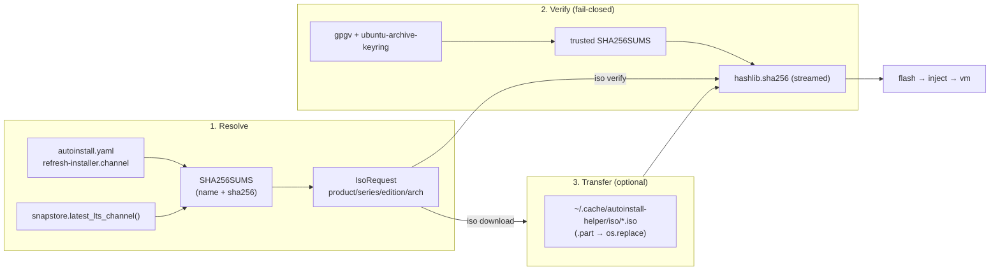

# Ubuntu ISO: Download & Integrity Verification

> [!IMPORTANT]
> Design for an `iso` command group that resolves, verifies (SHA-256 + OpenPGP, fail-closed) and downloads official Ubuntu
> installation media, extending the existing `flash` → `inject` → `vm` workflow with the missing first step.

## Problem

`flash` takes a local ISO and never checks it. Today a user must find the right file by hand on `releases.ubuntu.com`,
cannot tell a truncated download from a complete one, and has no way to confirm that what is about to be written to a USB
stick is an authentic Ubuntu image. The tool already resolves an installer channel for `validate`, but `flash` knows
nothing about the release the configuration targets, so the two halves of the workflow can silently disagree.

This document designs the missing step:

- **`iso verify`** — integrity check of an ISO the user already has (checksum + signature, no root, no Docker).
- **`iso download`** — resolve, stream, resume and verify an official ISO into a cache.
- **`iso list`** / **`iso verify <device>`** / optional `.zsync` delta update.

## Architecture



## CLI Surface

The group mirrors the existing `cidata` and `vm` groups; every command runs on the host without root and without Docker.

```text
iso list      [--series 26.04] [--product ubuntu|kubuntu|…] [--edition desktop|live-server]
              [--arch amd64] [--base-url URL] [--daily]

iso verify    FILE
              [--release 26.04 | --sums-file PATH --sums-sig PATH | --sha256 HEX]
              [--no-verify-signature] [--keyring PATH] [--quiet]

iso download  [--config autoinstall.yaml] [--series 26.04] [--product ubuntu]
              [--edition desktop] [--arch amd64] [--name <iso-name>]
              [--dir DIR] [--output FILE] [--mirror URL] [--base-url URL]
              [--no-resume] [--force] [--no-verify-signature] [-y] [--dry-run]
```

A fully specified run stays short because every axis has a default:

```bash
autoinstall-helper iso download                       # 26.04 desktop, host arch, into the cache
autoinstall-helper iso verify ubuntu-26.04-desktop-amd64.iso
sudo autoinstall-helper iso verify /dev/sdb --name ubuntu-26.04-desktop-amd64.iso   # milestone 3
```

## Sources and Catalogue

| Source | Content | Role |
| --- | --- | --- |
| `https://releases.ubuntu.com/<series>/SHA256SUMS` | checksums **and names** of every ISO of that series (desktop, live-server, wsl) | the **catalogue**; no HTML scraping |
| `https://releases.ubuntu.com/<series>/SHA256SUMS.gpg` | detached OpenPGP signature of the file above | authenticity of the catalogue |
| `https://cdimage.ubuntu.com/releases/<series>/release/SHA256SUMS` | all products (ubuntu, kubuntu, xubuntu, …) at release | used when `--product != ubuntu` |
| `https://cdimage.ubuntu.com/daily-live/current/` | current development series dailies | later (`--daily`) |

Measured facts that shape the design:

- **The filename is not constructible.** `releases.ubuntu.com/26.04/SHA256SUMS` lists `ubuntu-26.04-…` and
  `ubuntu-26.04.1-…` side by side, and `releases.ubuntu.com/24.04/` keeps only the current point release. The exact name
  must be looked up in the catalogue.
- **Both hosts honour HTTP `Range`** (`Accept-Ranges: bytes`, `206 Content-Range`), so resumable downloads and
  device read-back are feasible.
- **Signature verification works out of the box on Ubuntu:**

  ```console
  $ gpgv --keyring /usr/share/keyrings/ubuntu-archive-keyring.gpg SHA256SUMS.gpg SHA256SUMS
  gpgv: Good signature from "Ubuntu CD Image Automatic Signing Key (2012) <cdimage@ubuntu.com>"
  $ echo $?
  0
  ```

  The signer fingerprint is `843938DF228D22F7B3742BC0D94AA3F0EFE21092`; the key ships in `ubuntu-keyring`
  (`/usr/share/keyrings/ubuntu-archive-keyring.gpg`).

- **`gpg --verify` against the user keyring fails** (`Can't check signature: No public key`) on a stock host, so the
  system keyring must be targeted explicitly rather than relying on the default `~/.gnupg`.
- **Failures are distinguishable.** A modified manifest yields `BAD signature` and exit 1; a missing key yields
  `Can't check signature: No public key`. Both must be fatal.
- `.zsync` files exist for the server ISOs, but `zsync` is not installed by default → optional milestone.

### Name and series resolution

Grammar: `{product}-{series}[.{point}]-{edition}-{arch}[+variant].iso`
(e.g. `ubuntu-26.04.1-desktop-amd64.iso`, `kubuntu-24.04.3-desktop-arm64.iso`).

Resolution order:

1. **Pinned name** (`--name ubuntu-26.04.1-desktop-amd64.iso`) → exact match in the catalogue.
2. **Axes** — `--product` (default `ubuntu`), `--edition` (default `desktop`), `--arch`
   (default: `snapstore.ARCH_MAP[platform.machine()]`, i.e. the host architecture), `--series`. When several point
   releases match, pick the **highest**; prefer an exact `-<arch>.iso` over a `+variant` suffix, so
   `live-server-arm64+largemem.iso` never shadows `live-server-arm64.iso`.
3. **Series default** — the track from `autoinstall.refresh-installer.channel` when present, otherwise
   `snapstore.latest_lts_channel()`. This reuses the exact resolution `validate` already performs, so the ISO and the
   validated configuration stay aligned; the same caveat as in `validate` applies (the channel describes the installer
   snap, not the medium).
4. Nothing resolves → error listing the names available in the catalogue.

Catalogue parsing is a single regex over the manifest: `^(?P<sha>[0-9a-f]{64})\s+\*?(?P<name>\S+)$`.

## Module: `src/autoinstall_helper/iso.py`

Zero external dependencies (stdlib only): `urllib.request`, `hashlib`, `shutil`, `subprocess`, `re`, `os`, `pathlib`.
The only binary dependencies are `gpgv` (and the system keyring) — never a Python package, per the AGENTS.md
zero-dependency rule. Path metadata goes through the `fsprobe.probe()` seam like everywhere else.

```python
"""Ubuntu ISO resolution, integrity verification and download."""

from dataclasses import dataclass
from pathlib import Path

ISO_HOSTS = {
    "release": "https://releases.ubuntu.com",
    "flavours": "https://cdimage.ubuntu.com/releases",
}
SYSTEM_KEYRINGS = ("/usr/share/keyrings/ubuntu-archive-keyring.gpg",)
CD_IMAGE_FINGERPRINTS = ("843938DF228D22F7B3742BC0D94AA3F0EFE21092",)
CHUNK_BYTES = 1024 * 1024


@dataclass(frozen=True)
class IsoEntry:
    """One catalogue line: an ISO filename and its SHA-256."""

    name: str
    sha256: str


@dataclass(frozen=True)
class IsoRequest:
    """A resolved ISO selection."""

    product: str
    series: str
    edition: str
    arch: str


def fetch_catalogue(series: str, *, product: str = "ubuntu", base_url: str | None = None) -> list[IsoEntry]: ...
def resolve_iso(request: IsoRequest, catalogue: list[IsoEntry]) -> IsoEntry | None: ...
def fetch_manifest(series: str, dest: Path, *, base_url: str) -> tuple[Path, Path]: ...
def verify_manifest(sums: Path, sig: Path, *, keyring: Path | None = None) -> None: ...
def sha256_file(path: Path) -> str: ...
def sha256_prefix(path: Path, size: int) -> str: ...     # milestone 3: read-back of a device
def verify_iso(path: Path, entry: IsoEntry) -> bool: ...
def download_iso(url: str, dest: Path, entry: IsoEntry, *, resume: bool = True, ...) -> int: ...
```

`cli.py` only gains the `iso` group and a thin dispatch function, matching how `_dispatch_vm()` is written.

## Integrity Model (fail-closed)

Two independent layers, both mandatory by default:

1. **Authenticity of the catalogue.** `SHA256SUMS.gpg` is verified with `gpgv` against a keyring resolved from an
   ordered candidate list (`SYSTEM_KEYRINGS`, overridable with `--keyring`). The expected signer fingerprint is pinned
   and read from `gpgv --status-fd`, so a *valid* signature made by an unexpected key is rejected too.
2. **Integrity of the payload.** The SHA-256 of the ISO is compared with the entry from the verified catalogue. During
   `iso download` the hash is computed **while streaming** (single pass, no second read); `iso verify` reads the file
   once in 1 MiB chunks.

Rules:

- A SHA-256 mismatch is a failure; the file is never promoted to its final name.
- A signature failure or a missing key is a failure. There is no silent downgrade and no automatic key fetch.
- The single escape hatch is `--no-verify-signature`, which still enforces the SHA-256 check and prints a loud warning
  that the manifest was authenticated by HTTPS transport only.
- The **catalogue is always fetched from the canonical base URL**, even when the payload comes from `--mirror`, so
  third-party mirrors remain verifiable.
- Offline mode: `--sums-file` + `--sums-sig` verify against locally stored artifacts. `--sha256 HEX` is the last-resort
  mode and is documented as *not* authenticating the expectation.
- `iso download` compares the transferred byte count with the server's `Content-Length` **before** hashing, so a
  truncated transfer is reported as truncation rather than as a hash mismatch.

## Download Engine

- Streamed `urllib.request.urlopen` with `resp.read(CHUNK_BYTES)` — never an unbounded `read()`.
- **Resume**: write to `<file>.part`, send `Range: bytes=<offset>-`. A `200` answer (range ignored) or an unexpected
  `Content-Range` total restarts from zero. `--no-resume` opts out.
- **Atomic promotion**: verify first, then `os.replace(".part", final)`. On any failure the `.part` is kept and its path
  is reported, so a retry resumes where it stopped.
- **Progress** on stderr, throttled (at most one update per 0.5 s, always a final line): percentage, MiB/s, ETA; at most
  one line per 5 s when not a TTY.
- **Pre-flight**: total size from `Content-Length`, free space from `shutil.disk_usage`; refuse with a clear message when
  the filesystem cannot hold the image (the desktop ISO is ≈ 6.5 GB, the server ISO ≈ 3.3 GB).
- **Cache**: `${XDG_CACHE_HOME:-~/.cache}/autoinstall-helper/iso/`, overridable with `--dir` / `--output`. An already
  cached ISO that verifies against the current catalogue is reused (`--force` re-downloads).
- The command is documented as unprivileged; when `os.geteuid() == 0` it warns, because caching as root leaves
  root-owned files behind.
- `--dry-run` prints the resolved URL, name, size and destination without transferring the payload — which also makes
  the whole control plane recordable (see below).

## Recording / Replay Integration

The existing recorder reads the **entire** response body into memory and into the fixture
(`Recorder._wrap_urlopen` → `response.read()`), which is impossible for a multi-gigabyte ISO. Consequences:

- The download path must stream, and the recorder gains a body cap (`RECORD_MAX_BODY_BYTES`, default 8 MiB). Larger
  responses are journaled as `{"body": null, "body_skipped": true, "content_length": N}`; the replayer raises a clear
  `ReplayError` explaining that a skipped body cannot be served.
- The gigabyte transfer itself is **intentionally outside the replay tier**, and this is documented in
  `tests/replay/README.md`.
- Replay-friendly scenarios added to the scenario table:
  - `iso-verify-bad-hash` — a real signed `SHA256SUMS` plus a kilobyte ISO fixture: signature OK, hash mismatch → rc 1.
  - `iso-verify-bad-signature` — tampered `SHA256SUMS` with the real `.gpg`: `BAD signature` → rc 1.
  - `iso-list` — recorded catalogue fetch; asserts the resolved names.
  - `iso-download-dry-run` — resolved URL/name/size printed, no body at all.
- Unit tests (`tests/test_iso.py`) mock `iso.urllib.request.urlopen` and `iso.subprocess.run` at the point of use and
  cover resume, truncation, range-restart, disk-space refusal, cache reuse and the fail-closed signature paths.

## Error Handling

| Situation | Behaviour |
| --- | --- |
| Series/edition/arch absent from the catalogue | error listing the available names, rc 1 |
| Manifest signature invalid, or made by an unexpected key | error naming the fingerprint, rc 1, nothing downloaded |
| `gpgv` missing or no system keyring found | error with a `gpg --recv-keys` hint and the `--no-verify-signature` escape hatch, rc 1 |
| Truncated transfer (`Content-Length` mismatch) | error, `.part` kept, rc 1 |
| SHA-256 mismatch | error, `.part` kept, rc 1 |
| Not enough free space | error before a single byte is transferred, rc 1 |
| `iso verify` of a block device without root | `_require_root("iso verify a block device")`, exactly like `flash` |

## Testing Plan

| Tier | Coverage |
| --- | --- |
| Unit (`tests/test_iso.py`) | catalogue parsing, resolution (point-release and `+variant` precedence), manifest/signature branches, resume, truncation, disk-space refusal, cache reuse, `--dry-run` output |
| Replay (`tests/replay/`) | the four scenarios above; requires committing a kilobyte ISO fixture and a real `SHA256SUMS`/`.gpg` pair |
| Smoke (`tests/smoke/`) | optional: `iso download --dry-run` against the real network with the packaged `.pyz` |

## Documentation Updates

- `README.md`: Key Features bullet, Project Structure (`iso.py`), System Requirements (`gpgv` + `ubuntu-keyring`),
  a Usage Guide section 6, and the table of contents.
- `tests/replay/README.md`: the four new scenarios and the body-cap rule.
- `.github/workflows/ci.yml`: the `pytest -m replay` step, once the first recording lands (as already planned).

## Design Decisions

| Decision | Choice | Rationale |
| --- | --- | --- |
| Catalogue source | `SHA256SUMS` from the canonical host | It carries names *and* hashes in one small signed file; no HTML scraping, no hardcoded filename pattern |
| Integrity policy | Fail-closed on checksum **and** signature | Consistent with the tool's "validation is strict by default" philosophy; a corrupt USB stick wastes an installation cycle |
| Signer identity | Pinned fingerprint, system keyring | `ubuntu-keyring` is present on every supported host, so verification needs no network or user setup |
| Keyring discovery | Ordered candidate list, `--keyring` override | Zero-config on Ubuntu without hardcoding a single path for every environment |
| Escape hatch | `--no-verify-signature` only | One explicit, loud downgrade instead of a silent one; SHA-256 always applies |
| Hashing | `hashlib` over a chunked read | Single pass while downloading; no dependency and no parsing of `sha256sum` output |
| Transport | `urllib.request` | Consistent with `snapstore.py`; keeps the zero-dependency rule |
| Mirror support | `--mirror` for the payload, canonical host for the manifest | Third-party mirrors stay verifiable |
| Resume | `.part` + `Range`, restart on `200`/mismatch | Both hosts honour `Range`; a 6.5 GB transfer must survive an interruption |
| Cache | XDG cache dir, verified on reuse | Download once, flash many times; `--dir`/`--output` still allow full control |
| `flash` coupling | None — separate commands | `flash` on a block device needs root; downloading as root is a worse default |
| Recordability | Streaming transport + a recorder body cap | Keeps the replay tier hermetic without putting gigabytes into a fixture |

## Known Limitations

- **Enormous transfers are not replayable.** The recorder body cap makes `iso download`'s control plane recordable, but
  the payload transfer itself is only covered by unit tests and (optionally) smoke tests.
- **Trust in the system keyring.** Verification is as trustworthy as `/usr/share/keyrings/ubuntu-archive-keyring.gpg`;
  on a non-Ubuntu host the tool must fail with a clear message rather than proceed.
- **Pinned key rotation.** If Canonical rotates the CD signing key, the fingerprint list must be updated; keeping a list
  lets the old and the new key stay valid during a transition.
- **Mirror caveats.** `--mirror` moves the payload to a third party: it stays verifiable, but mirror availability and
  staleness become new failure modes.
- **Point-release drift.** `releases.ubuntu.com/<series>/` moves forward as point releases ship, so an unpinned
  `iso download` can fetch a newer image than the one validated earlier; `--name` pins it.

## Milestones

1. **M1 — `iso verify`.** Catalogue parsing, manifest fetch, `gpgv` verification, `sha256_file`, offline flags, README
   section, unit tests. This is the smallest change that delivers "at least integrity verification".
2. **M2 — `iso download` + `iso list`.** Resolution, streaming download with resume, cache, progress, `--dry-run`,
   pre-flight space check, recorder body cap, replay scenarios.
3. **M3 — extensions.** `iso verify <device>` (root, prefix hashing), `--daily` (cdimage), `--zsync` delta updates, and
   a `flash` option that rejects or marks unverified ISOs.

## Open Questions

1. **Should `flash` refuse an unverified ISO by default?** A cached checksum sidecar written by `iso download` would let
   `flash` warn without re-hashing 6.5 GB; `--allow-unverified` would keep manual downloads workable.
2. **Should `iso download` support parallel ranged segments?** It would saturate fast links but multiplies the failure
   modes; the sequential resume path is the conservative default.
3. **Should the desktop edition be the default?** It matches the `ubuntu-desktop-bootstrap` installer the validator
   targets, but the server ISO is smaller and is the classic autoinstall medium.
4. **Where should the `+variant` filter stop?** `arm64+largemem` is a legitimate variant; a `--variant NAME` flag may be
   needed if more variants appear.
